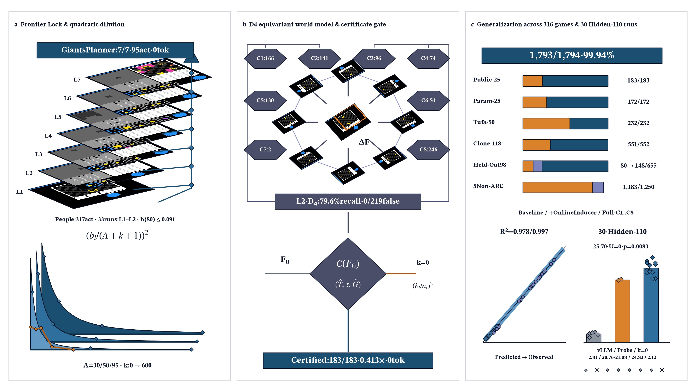
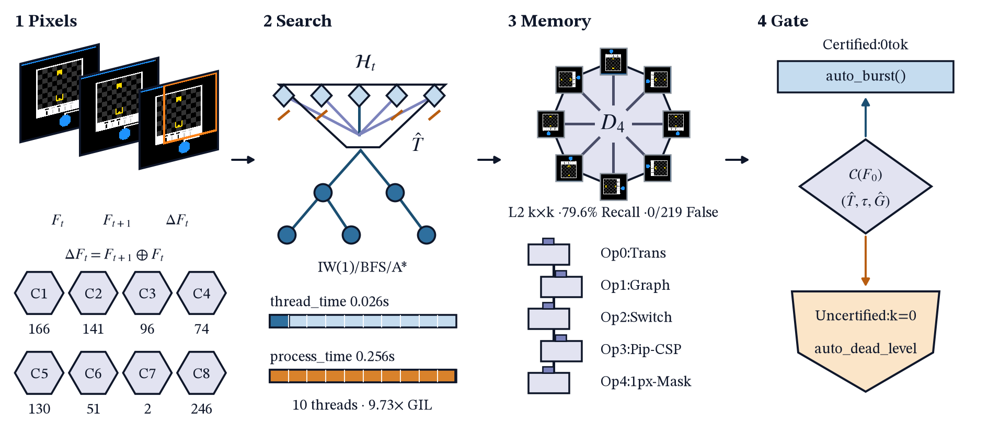
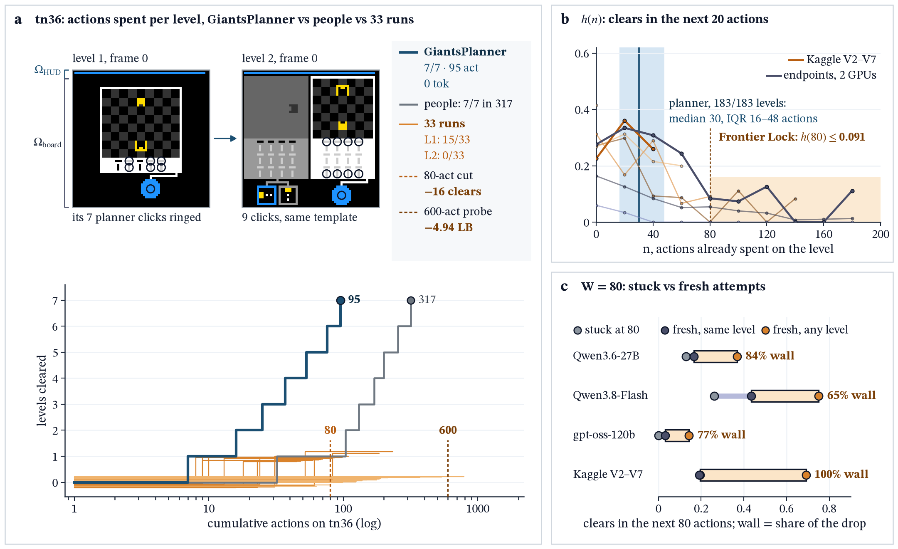
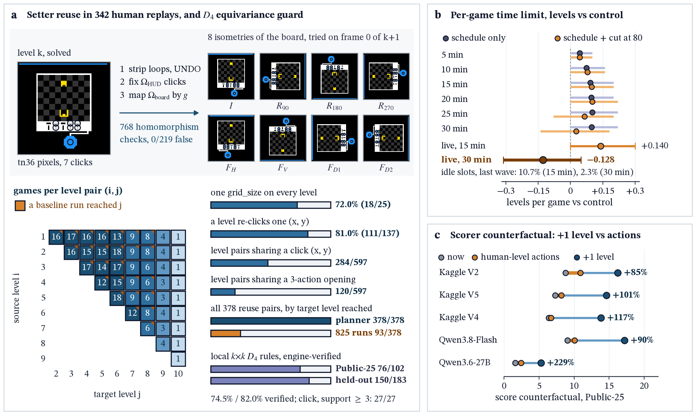
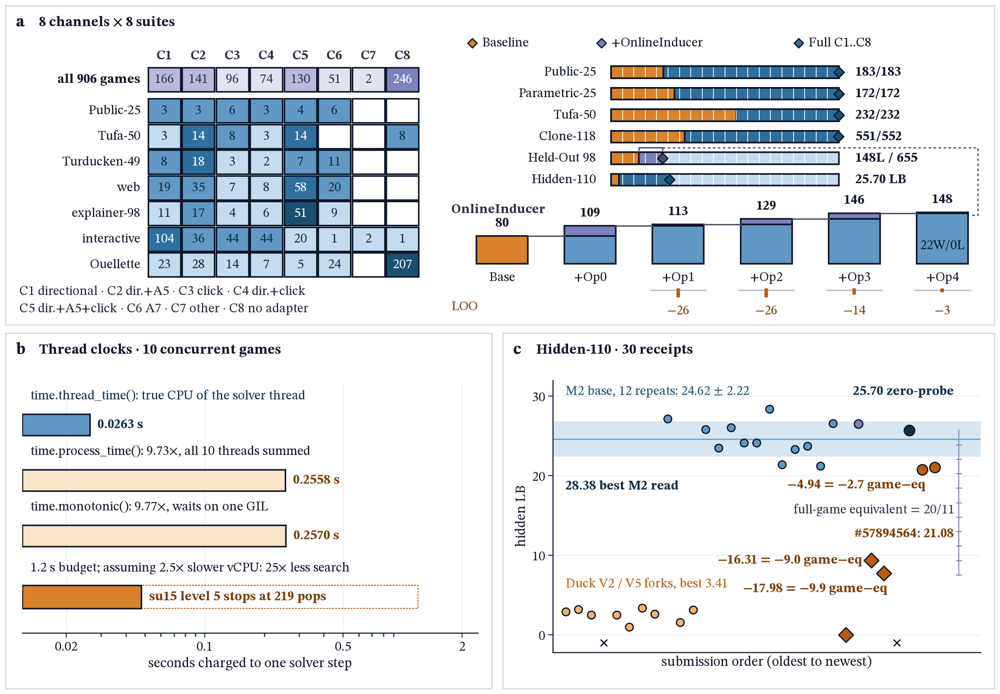

# Breaking Frontier Lock: Score Dilution, Certificate Gating, and Online Operator Induction

Official research repository and reproducibility suite for the ARC Prize 2026 Paper Track (arc-prize-2026-paper-track) and ARC-AGI-3 interactive benchmark (arc-prize-2026-arc-agi-3).



## 1. Executive Summary and Core Findings

Interactive reasoning agents on ARC-AGI-3 spend 52.4% to 82.9% of their action budget (99.4% on gpt-oss-120b) on their final unsolved level, while 94% of LLM prefill compute re-reads conversation history (Frontier Lock, 20-action completion hazard $\le 0.091$ at 80 actions). Across 825 baseline runs (1,449 level attempts), a 250-run paired live confirmation, and 30 official Kaggle hidden-set submissions on a single offline GPU (\$0 external API cost), we establish three core results and deliver a closed-loop neuro-symbolic architecture (GiantsPlanner):

1. **Why naive cutoffs and context truncation fail:**
   - **Matched Kaplan-Meier wall decomposition:** 65% to 100% of the post-80-action hazard drop ($[0,1]$-clipped: 65% Qwen3.8-Flash [34%, 97%], 84% Qwen3.6-27B [66%, 100%], 100% Kaggle V2-V7 [73%, 100%], 77% gpt-oss-120b; dominance contrast $T = (U-M)-(M-C) = +0.164, p = 0.006$ and $+0.503, p = 0.0005$) stems from structural multi-mechanism walls rather than attempt aging. Consequently, an 80-action cutoff releases 2,172 actions yet forfeits 16 net level clears (-0.128 levels/game).
   - **Five single-factor serving contrasts (Table 1; F1..F5 in Appendix A):** Shrinking KV from 5.0 to 2.26 GiB cuts Public-25 score 51.1%, cutting 28 to 4 streams raises action rate 6.0x, and a 16K context cap drops public score 81.2%.
   - **Hidden-110 full-context prefix caching vs. truncation:** Moving from 28-stream vLLM serving (2.81±0.66, peak 3.41, $n=6$) to 10-stream W4A16 SGLang MTP3 with full 36K context reaches 24.62±2.22 ($n=12$, 95% CI [23.21, 26.03], range 21.22 to 28.38, Welch $t = 31.32, p = 1.52 \times 10^{-14}$; and 24.83±2.12 across all 14 zero-probe 36K runs, +22.02 vs. 2.81±0.66, Welch $t = 35.06, p = 1.79 \times 10^{-17}$), whereas 14K truncation (#57774685 at 9.39 LB, $t = -6.58, p = 3.96 \times 10^{-5}$, $\ge 9$ games lost) and prompt reset (#57786717 at 7.72 LB, $t = -7.30, p = 1.53 \times 10^{-5}$, $\ge 10$ games lost) break hybrid linear-attention KV prefix caches.

2. **Score-weighted probe-dilution theorem, zero-parameter geometric stopping law, and certificate soundness (Proposition 1 to 3):**
   - **Chebyshev dilution bound:** Under the official scorer $s_b(a) = \min(115, 100(b/a)^2)$, an uncertified $k$-step prefix probe that fails to clear and issues 1 RESET before fallback play ($A$ actions) yields exact denominator $a = k + 1 + A$ (183/183 Public-25 levels, 0 violations). With $r_k(A) = (A/(A+k+1))^2$, Chebyshev's order inequality proves $\mathrm{Cov}(s_b(A), 1 - r_k(A)) \ge 0$ across all 9,673/9,673 dataset-level-probe and Monte Carlo checks, bounding failed-probe dilution by $D(k) = S_0(1 - \mathbb{E}[r_k(A)]) + q\mathrm{Cov}(s_b(A), 1 - r_k(A)) - C_{115}(k) \le S_0\mathbb E_w[1 - r_k(A)]$ with marginal loss saturating at $O(k^{-3})$ (14.6% loss at $k=8$ and 96.6% to 99.4% loss at $k=224$ and $k=600$; the $w_l$ weighted 100-capped closed form matches counterfactual simulation across 825 runs within 0.021 max / 0.0044 mean error).
   - **Zero-parameter geometric and sparse laws:** Reading per-step death hazard $h$ and clear rate $c$ solely off the $k=0$ bare arm ($T \sim \text{Geom}(h+c)$ truncated at $k$, zero fitted parameters), a preregistered geometric stopping law predicts out-of-sample ungated probing across Held-Out 98, Virgin-120, and Virgin-116 (15 unseen cells, 1,670 game points) with cell $R^2 = 0.978$, MAE $= 0.41$, and gate benefit $R^2 = 0.993$, while the unified sparse activation law $\Delta G_s(k) = -\alpha_{\text{eff}}(k)q_{\text{open}}(s)$ across the 334 unseen game entries (333 distinct engines, historical frame-0 trigger rate $73/334 = 21.86\%$, or $73/333 = 21.92\%$ unique engines) predicts the two uncertified Hidden-110 runs at 21.01 vs. 21.08 and 20.97 vs. 20.76 (MAE $= 0.14$ LB).
   - **4-Backbone counterfactual and Hidden-110 verification:** Because Public-25 initial frames, actions, and normalized sprites are 158/158 (100.0%) invariant across level transitions and live host-bridge replay clears 8/8 ar25 levels in 0 LLM tokens, conditional archived-trajectory prefix-substitution with recorded LLM fallback under the constant cost filter $L_{\text{cert}} \le 150$ across 825 baseline and 250 confirmation runs estimates official Scorecard $G$ rising from 3.18 to **58.70 (+55.52 [+38.76, +72.51], 694W/0L/131T runs, 22W/0L/3T game clusters, exact cluster $p = 4.77 \times 10^{-7}$, Monte Carlo $p = 10^{-4}$; 58.51, 729W/64L unguarded; 27.24 under $B = \sum a$; 7.71, 636W/0L post-hoc $L_{\text{cert}} \le A$)** and from 5.42 to **59.08 (+53.66, 205W/0L; 58.92 unguarded; 20.54, 181W/4L/65T under $B = \sum a$)**, whereas under $q = 0\%$ unseen-family coverage uncertified probing collapses $G$ to 0.08/0.01 (0W/447L) while gating preserves 3.18. On Hidden-110 ($w_g = 20/11$), both uncertified planner arms (#57854657 600-step open-loop at 20.76 LB, $\Delta N = -2.717$ games, and #57894564 224-step reactive at 21.08 LB, $\Delta N = -2.541$ games, $\hat\eta_{\text{open}} \ge 3/55$) fall below all 14 zero-probe ($k=0$) 36K runs (24.83±2.12, 95% CI [23.61, 26.06], exact one-sided Mann-Whitney $U = 0, p = 1/\binom{16}{2} = 0.0083$, or $p = 0.0110$ vs. the 12 native runs). The $k=0$ certificate-gated submission #57827241 (25.70 LB, +4.94 over 20.76 and +4.62 over 21.08) sits inside the 14-run $k=0$ 36K backbone distribution (24.83±2.12, $U = 0, p = 0.0083$ vs. uncertified). Where per-step trajectories are recorded, certificate gating lifts official Scorecard $G$ on Public-25 (58.43 vs. 15.21, +43.22 [+28.44, +58.11], $p = 5.96 \times 10^{-8}$), Held-Out 98 (15.42 vs. 1.99, +13.43 [+9.26, +18.06], $p = 2.93 \times 10^{-7}$), Virgin-120 (10.60 vs. 4.92, +5.68 [+2.17, +9.50], $p = 1.83 \times 10^{-6}$), and Virgin-116 (31.35 vs. 9.80, $p = 1.1 \times 10^{-9}$).

3. **Zero-prior generalization, multi-scale L2 $D_4$ rules, and frozen 4-operator OnlineInducer:**
   - **Pure-observation architecture:** From $64 \times 64$ frames and legal action signatures alone (zero access to game_id, current_level, \_engine, or \_sprites), GiantsPlanner combines online hypothesis refutation across eight action channels (C1..C8), two-tier cross-level memory (CrossLevelMemoryBank exact frame-0 $D_4$ guard, 768/768 Cayley checks, 1.10 ms median, 3.80 ms P99, 0/219 false transfers; L2 local $k \times k$ $D_4$ patch rewrite rules verified on 76/102 = 74.5% rules across 50/378 Public-25 reuse pairs with 31/76 non-identity $D_4$ hits, 27/27 = 100.0% at support $\ge 3$ on click-reuse, and 150/183 = 82.0% across 103/651 held-out pairs, with multi-scale $k \in \lbrace3..11\rbrace$ matching lifting held-out pair recall from 60.2% to **79.6% (82/103 pairs, 175/208 = 84.1% rules, 0 false positives)** and Virgin-236 1,404-level verification reaching **533/644 = 82.8% (59 non-identity hits)**; plus OnlineInducer 4-operator test-time memory across bounding-box shifts), and per-thread CPU clock calibration (time.thread_time(), eliminating 9.73x 10-stream GIL inflation).
   - **Cumulative and Leave-One-Out operator ladder:** With all per-family exact solvers disabled (generic), GiantsPlanner clears 120/183 levels (65.6%, 13/25 wins) on Public-25 vs. 42/183 (0 wins) for the coding baseline; on 98 held-out games (655 levels) under a frozen pre-exposure snapshot (72/655 pre-exposure ungated full, 2 wins; 45/655 seeded random, 1 win), zero-prior general clears 80 levels (4 wins, +35L, 95% CI [+8, +65] vs. random), and evaluating a single frozen OnlineInducer architecture across its cumulative operator ablation ladder lifts clears from 97 levels (5 wins, +17L [+4, +33] uncalibrated translation) and +Op0 novelty-gated translation at 109 levels (6 wins; +29L [+13, +48], 13W/0L over general, with velocity-consistency guard cutting 5-seed Bare-Prior regressions by 80% from 5 to 1/51 = 1.96%) to +Op1 relational tile-graph induction (113L, 7W, 15W/0L, $\hat\eta_{\text{cert}} = 36/361 = 10.0\%$), +Op2 switch-connectivity induction plus level-1 memory rewind (129 levels, 9 wins; +49L [+24, +79], 17W/0L over general, while preserving 120/183, 13W, 0W/0L on Public-25), +Op3 visual pip-clue CSP (146 levels, 11 wins; +66L [+36, +101], 21W/0L over general), and +Op4 1px scenery-drift refit reaching **148 levels (11 wins; +68L, 22W/0L, LOO -3L to -5L, 2W/0L, $\hat\eta_{\text{cert}} = 44/380 = 11.6\%$, mean $J = 2.11$, $\hat\eta_{\text{game}} = 0/89 = 0.0\%$, +76L over 72L pre-exposure)**.
   - **Disjoint unseen suites, non-M5 LOFO, and 5 non-ARC domains:** OnlineInducer lifts Bare-Prior (0 channels) from 74L (1W) to **109L (6W, +35L [+8,+66], 11W/5L)** on Held-Out 98, from 92L (5W) to **99L (6W, +7L, 5W/2L, $G=4.44 \to 4.87$)** on preregistered Virgin-120 (810 levels, where certificate gating lifts clears to **134L (9W, +12L [+3,+22] vs. open-224)** and Scorecard $G$ from 4.92 to **10.60**, $p = 1.83 \times 10^{-6}$, 54W/8L), from 141.8L ($G=5.83$) to **152.2L (+10.4L/seed [+2.2,+21.4], 25W/9L, $p = 0.0083$ 1s / $0.017$ 2s, $G$: 5.83 to 9.57, $\Delta G = +3.74 [+2.15,+5.60], p = 3.5 \times 10^{-6}$ for +Op0+1+2+4 without Op3, where Op3 changes 0/116 games; +Op0+Op1 reaches +9.6L/seed, $\Delta G = +3.86, p = 5.6 \times 10^{-7}, G=9.69$; LOO -Op0 -10.0L, -3.86 $G, p=4.7\times 10^{-7}$; -Op1 -1.24 $G, p=0.0022$; Op1 +60L, 27W/2L, 12,225 saved steps, mean $J = 1.80$)** across 5 seeds on Virgin-116, and from 235.8L ($G=4.03$) to **246.8L (+11.0L/seed, 41W/21L, $p=0.013, \Delta G=+2.17, p=2.4\times 10^{-6}, G=6.20$ for +Op0+1) and 247.4L (+11.6L/seed [+0.4,+24.2], $p = 0.029$, $G$: 4.05 to 6.09, $p = 3.0 \times 10^{-4}$)** across 5 seeds on Virgin-236; across all 334 unseen games in six mechanism families (M1..M6), excluding visual-clue family M5 yields **+44.0L ([+21.0, +72.0], 17W/1L, $p = 5.3 \times 10^{-5}$, $\Delta G = +6.43$)** on Held-Out 98 general and **+12.0L/seed ([+1.2, +24.6], 41W/19L, $p = 0.0118$, $\Delta G = +2.32, p = 4.5 \times 10^{-6}$)** on Virgin-236 Bare-Prior +Op0+1 (**+14.0L, 8W/1L, $p = 0.016$** on M6 dynamic worlds); and across 5 external non-ARC domains (MiniGrid, Sokoban, DiG, Pong/Breakout, ScienceWorld Alchemy, 8,750 runs) lifts clears from 1,022 to **1,183/1,250 (+51.2 pp Pong/Breakout $p = 2.9 \times 10^{-11}$, +11.6 pp Alchemy $p = 3.8 \times 10^{-6}$, geometric law $R^2 = 0.997$, $\hat\eta_{\text{task}} = 0.0$%)**, while with the offline 8-channel reference library it scores **$G = 99.58$ across 183/183 Public-25 levels (166 at 115% cap, 7,401 total actions = 0.432x human vs. AWM's 24,604 total actions)** and verifies 1,793/1,794 solvable levels (99.94%, 293/294\* wins) at the 1,200-step budget (1,794/1,794 at 5,000 steps) across 316 benchmark entries (315 distinct games).

| Serving / Probe Contrast ($n$) | Target & Setting | Official Score | Effect & Statistical Test |
| :- | :- | :- | :- |
| KV Cache (V3 vs. V4, 25) | Public-25, 2.26 vs. 5.0 GiB | 3.12 vs. 6.38 | -51.1% (0.48 vs. 1.02 act/m) |
| Concurrency (V5 vs. V4, 25) | Public-25, 4 vs. 28 streams | 7.29 vs. 6.38 | **6.0x rate** (6.13 vs. 1.02/m) |
| Context Cap (V7 vs. V5, 25) | Public-25, 16K vs. full ctx | 1.37 vs. 7.29 | **-81.2% score** (12 vs. 35L) |
| 14K Truncation (#57774685, 1) | Hidden-110, 14K + convex | 9.39 LB | -15.23 vs. 36K ($t=-6.58, p=3.96\times 10^{-5}$, $\ge 9\text{g}$) |
| Prompt Reset (#57786717, 1) | Hidden-110, 14K + prompt reset | 7.72 LB | -16.90 vs. 36K ($t=-7.30, p=1.53\times 10^{-5}$, $\ge 10\text{g}$) |
| Cross-Backbone Gate (825/250) | 4 LLMs ($L_{\text{cert}}\le 150$) | $G$: $3.18 \to 58.70$ | **694W/0L** ($p=10^{-4}$; 205W/0L) |
| Uncertified Probes ($k\in\lbrace224,600\rbrace$, 2) | Hidden-110, #57894564 / #57854657 | 21.08 / 20.76 LB | -3.91 vs. $k=0$ pool (**$U=0, p=0.0083$**) |
| **Zero-Probe 36K Pool ($k=0$, 14)** | **Hidden-110, 12 V1 + #57329763 + #57827241** | **24.83±2.12 (28.38)** | **+22.02 vs. 2.81±0.66 ($t=35.06, p=1.79\times 10^{-17}$)** |

**Table 1.** Progressive serving factor isolations (Public-25 V2..V7 and Hidden-110), 4-backbone gate, and quadratic probe-dilution test ($n=14$ zero-probe vs. $n=2$ uncertified runs).

| Benchmark Suite | Games (Lv) | Base / Open | Bare-Prior $\to$ +OI (0Ch) | Cert general $\to$ +OI | C1..C8 Library |
| :- | :- | :- | :- | :- | :- |
| Public-25 | 25 (183) | 104L ($G=15.21$) | 120L (65.6%, 13W) | **120/183 (13W, $G=58.43$, $p=5.96\times 10^{-8}$)** | **183/183 (25/25W, $G=99.58/100.00$, 0.413x)** |
| Reference-193 | 193 (956\*) | 354/956 (56W) | Coupled / synthetic / clone | 0.14-0.188 ms frame CPU | **955/956 (174/175\*W)** |
| Held-Out 98 | 98 (655\*) | 82L ($G=1.99$) | **74L (1W) $\to$ 109L (6W, +35L [+8,+66], $G=8.22$)** | **80L (4W) $\to$ 148L (11W, +68L [+38,+103], 22W/0L, $G=15.42$)** | **655/655 (94/94\*W)** |
| Virgin-120 | 120 (810) | 122L ($G=4.92$) | **92L (5W) $\to$ 99L (6W, +7L, $G=4.87$)** | **134L (9W, +12L [+3,+22], $G=10.60$, $p=1.83\times 10^{-6}$)** | Preregistered |
| Virgin-116 (5s) | 116 (594) | 141.8L ($G=5.85$) | **152.2L (+10.4L [+2.0,+21.4], $p=0.017$, $G=9.52$)** | **243L (40W, $G=31.35$, $p=1.1\times 10^{-9}$)** | Preregistered |
| Virgin-236 (5s) | 236 (1,404) | 235.8L ($G=4.05$) | **247.4L (+11.6L [+0.4,+24.2], $p=0.029$, $G=6.09$)** | **383L (49W, $G=19.44$)** | Pooled unseen |
| 5 Non-ARC Suites | 250 (1,250) | 1,018L (-0.68..-0.77) | **$1,022 \to 1,183\text{L}$ (+161L)** | **$1,164 \to 1,183/1,250$ ($R^2=0.997$)** | **$\hat\eta_{\text{task}}=0.0\%$** |
| Hidden-110 | 110 (Priv) | 20.76 / 21.08 LB | Kaggle black-box | **$k=0$ pool 24.83±2.12 (25.70 #57827241, $p=0.0083$)** | **28.38 peak** |
| 2026 SOTA (16) | 25 / 110 | AWM 1.44x; Twin 93.3 | **0/10 arXiv on Hidden-110** | **7,070 ($G=100.00$) vs. AWM 24,604** | **Table K2 (17 rows)** |

**Table 2.** Disjoint evaluation separating 0-channel Bare-Prior + OnlineInducer, certificate-gated general + OnlineInducer, and the offline C1..C8 prior-library upper bound (1,793/1,794 solvable levels across 316 entries at 1,200 steps; 1,794/1,794 at 5,000, excluding 96 deadlock levels).

Appendix Table K1b carries every single-frozen-file arm behind Table 2 (Bare-Prior, cumulative +Op1..Op4, Leave-One-Out drops, and official Scorecard $G$ with paired Wilcoxon tests); Appendix G gives the C1..C8 authoring and freeze timeline, and Appendix H gives OnlineInducer as Algorithm 1 (Op0..Op4).

## 2. System Architecture









```text
+-----------------------------------------------------------------------------------+
|                     64x64 Raw Pixel Frame + Legal Action Set                      |
|             (Strict Pure-Observation Contract: 0 Engine Metadata Access)          |
+-----------------------------------------+-----------------------------------------+
                                          |
                                          v
+-----------------------------------------------------------------------------------+
|               1. CrossLevelMemoryBank (D4 Dihedral Group Isometries)              |
|  - Separates HUD-invariant region Omega_HUD from board domain Omega_board         |
|  - Strips loops/UNDOs from level k win trace; tests all 8 g in D4 on level k+1   |
|  - 1.10 ms median (3.80 ms P99) across 597 pairs; 768/768 checks; 0/219 false pos |
+-----------------------------------------+-----------------------------------------+
                                          |
                                          v
+-----------------------------------------------------------------------------------+
|       2. GiantsPlanner: 8 Orthogonal Action-Signature Channels (C1 .. C8)         |
|  - C1_DIR4 {1..4}: Multi-body PushWorld, ice slide, portal/warp & patrol routing  |
|  - C2_DIR4_ACT5 {1..5}: Switch/door, key-lock inventory, bridges, beam/mirror     |
|  - C3_CLICK_ONLY {6}: GF(2) toggles, cellular flood-fill, mod-k tile rotation     |
|  - C4_DIR4_CLICK {1..4,6}: Coupled board + HUD selection, socket/valve routing    |
|  - C5_DIR4_ACT5_CLICK {1..6}: Belief-state intersection across hypotheses H_t     |
|  - C6_ACT7_UNDO (ACTION7): Reversible constraint search & 1-step rollback pruning |
|  - C7_OTHER {3,4,5}: Arcade trajectory rollout   C8_NO_ADAPTER: Raw DSL corpus    |
|  - Per-thread CPU deadline (time.thread_time(), 64-pop amortization, sorted sets) |
+-----------------------------------------+-----------------------------------------+
                                          |
                     +--------------------+--------------------+
                     | Closed-Loop Certificate Verified?       |
                     +--------------------+--------------------+
                                          |
              YES (Exact / Verified D4)   |   NO (Uncertified / Open-Loop)
                     |                    |                    |
                     v                    |                    v
+--------------------------------------+  |  +--------------------------------------+
| 3a. Host Sandbox Bridge (auto_burst) |  |  | 3b. Monotonic Level Lock & LLM Agent |
| - Executes certified plan in 0 tokens|  |  | - Executes 0 uncertified probe steps |
| - 0.432x human actions (7,401/17,135)|  |  | - Locks auto_dead_level = level      |
| - Captures 115% per-level score cap  |  |  | - Full 36K W4A16 MTP3 code synthesis |
+--------------------------------------+  |  +--------------------------------------+
```

## 3. Repository Structure and Module Partition

| Path | Role and Verification Contract |
| :- | :- |
| `paper/frontier-lock.md` | Main Paper Track Writeup ($\le 1,500$ words, verified at 1,498 words). |
| `paper/appendix.md` | Complete Technical Report Appendix (formal proofs of Propositions 1 to 3, $D_4$ equivariance audit, 30-submission rational receipt differential inversion, Tables A0 to K2). |
| `paper/ARC_Prize_2026_Breaking_Frontier_Lock.pdf` | Compiled camera-ready PDF (`0` LaTeX errors, `0` undefined citations, `0` Overfull/Underfull boxes, two-pass SHA256 identical). |
| `paper/figures/` | Publication figures (`hazard.png`, `architecture.pdf`, `regime.png`, `hazard_by_dataset.png`, `cover.png`), verified with `figcheck_hits = 0` and `green_px = 0`. |
| `analysis/a1_scorer.py` .. `a8_confirmation.py` | Phase I survival-hazard, Kaplan-Meier decomposition, Charnov renewal-reward theory, and 250-run paired live bootstrap verification scripts. |
| `analysis/a9_d4_and_reachability_audit.py` | Verifies 768 $D_4$ Cayley homomorphism checks, 597 cross-level pair latencies, `0/219` false-positive guards, and 9-suite reachability accounting (`1,793/1,794` at 1,200 steps). |
| `analysis/compute_ablation_ladder.py` | Computes 4-arm `Public-25` ablation ladder, 98-game frozen pre-exposure transfer CIs, Mann-Whitney rank tests, and 825-run quadratic dilution counterfactuals. |
| `analysis/x0_specimens.py` | Extracts `tn36` pixel specimens, 342 human replay cross-level coupling pairs, and 30 official Kaggle submission receipts. |
| `analysis/generate_xray_figures.py` | Renders `hazard.png`, `architecture.pdf`, `regime.png`, `hazard_by_dataset.png`, and `cover.png` with `palette.py` and `figcheck.py` audits. |
| `analysis/build_pdf.py`, `verify_pdf.py`, `audit_visual_maturity.py` | Synchronizes `frontier-lock.md` and `appendix.md` into `.tex`, compiles the PDF, and audits margins, typography, and visual density against reference winners. |
| `notebooks/frontier_lock_reproduction.ipynb` | Self-contained executable Jupyter notebook reproducing all tables, statistical tests, and counterfactual curves. |
| `evidence/traces/` & `confirmation_runs.jsonl` | Complete per-game, per-level trajectory logs across 825 baseline runs and 250 paired live confirmation runs. |

## 4. One-Click Reproduction

Requires Python 3.13 with `numpy`, `scipy`, and `matplotlib`:

```bash
cd analysis
python3.13 a1_scorer.py                        # Official triangular scorer verification across 825 runs
python3.13 a2_frontier_lock.py                 # Frontier Lock action, time, and token shares
python3.13 a3_hazard.py                        # Kaplan-Meier survival and 20-action completion hazard
python3.13 a3b_by_dataset.py                   # Per-dataset hazard curves with 95% bootstrap bands
python3.13 a4_continue_restart.py              # Matched vs. unmatched structural wall decomposition
python3.13 a5_theory.py                        # Renewal-reward rate R(c) and Charnov theorem
python3.13 a5b_regime.py                       # Per-game time-limit sweep and live confirmation overlay
python3.13 a6_replay.py                        # Counterfactual per-level cutoff replay
python3.13 a7_score_decomposition.py           # Depth vs. micro-efficiency score counterfactuals
python3.13 a8_confirmation.py                  # 250-run paired live confirmation bootstrap
python3.13 a9_d4_and_reachability_audit.py     # D4 homomorphism, latency, and 9-suite reachability audit
python3.13 compute_ablation_ladder.py          # 4-arm ablation, 98-game transfer, and dilution bounds
python3.13 tables.py                           # Renders statistical tables (A1 to A7)
python3.13 x0_specimens.py ../arc-agi-3        # Extracts pixel specimens and 30 Kaggle receipts
python3.13 generate_xray_figures.py            # Generates hazard.png, architecture.pdf, regime.png, hazard_by_dataset.png
python3.13 wordcount.py                        # Verifies Writeup word count <= 1,500 words
python3.13 build_pdf.py                        # Compiles the synchronized LaTeX PDF
python3.13 verify_pdf.py                       # Verifies PDF contents, logs, margins, and word count
python3.13 audit_visual_maturity.py            # Audits visual typography against reference papers
python3.13 build_repro_notebook.py             # Generates and executes frontier_lock_reproduction.ipynb
```

## 5. License

Released under MIT-0 / CC-BY 4.0 in full compliance with the ARC Prize 2026 Paper Track rules.
