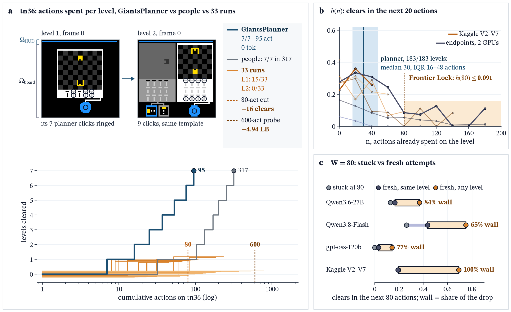
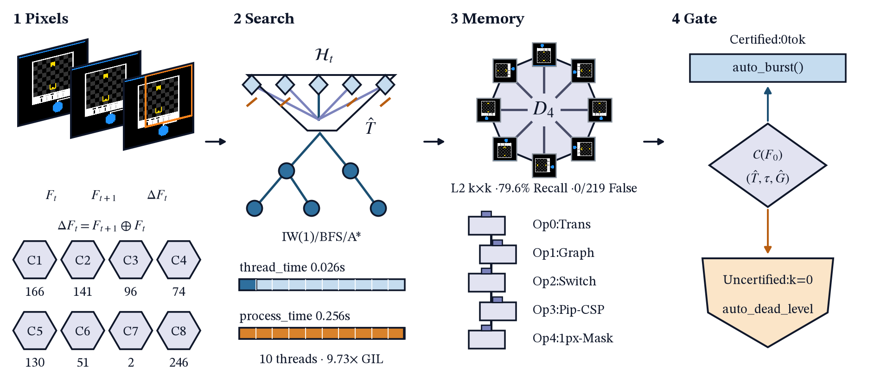
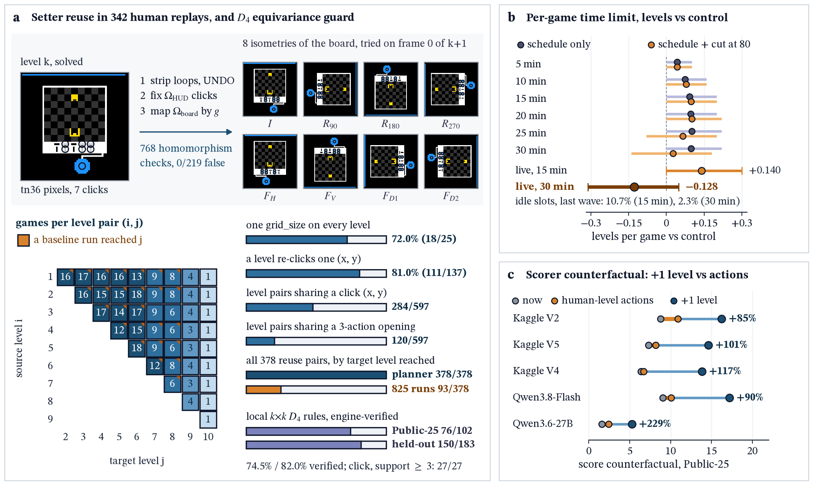
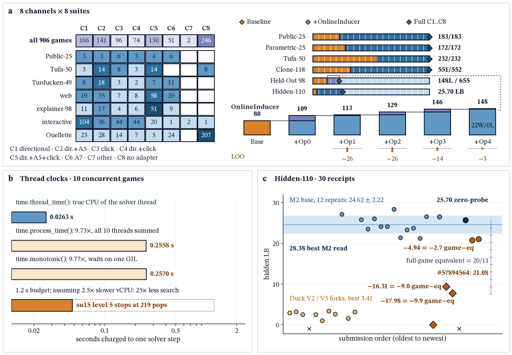

## Abstract

Neuro-symbolic world-model synthesis solves 183/183 Public-25 levels at G=99.58 (100.00 loop-erased, 0.413x human, 0tok) and 1,793/1,794 levels across 316 games, yet cutoffs and open-loop probing backfire across 825 baseline, 250 confirmation, and 30 Kaggle runs. Agents spend 52.4-82.9% of actions on their final unsolved level (≤0.091 hazard at 80), where Kaplan-Meier matching attributes 65-100% of slowdown to walls: 80-action cutoffs lose 16 clears and 14K truncation drops Hidden-110 from 24.62±2.22 (28.38) to 9.39 LB. Under (bₗ/aₗ)², Chebyshev's identity proves failed k-step probes dilute score after RESET, while 0-parameter geometric (R²=0.978,0.997) and sparse (MAE=0.14) laws predict loss: certificate gating lifts G from 3.18 to 58.70 across 4 backbones, and Hidden-110 probing (21.08,20.76) trails all 14 k=0 runs (24.83±2.12, 25.70 gated, U=0,p=0.0083). Local D₄ rules (79.6% recall) and zero-prior OnlineInducer lift Held-Out 98 to 148/655 (+68L,22W/0L), Virgin-116/236 by +10.4/+11.0L/seed, and 5 non-ARC suites to 1,183/1,250.

**Keywords:** Interactive Reasoning, Program Induction, Neuro-Symbolic World Models, Test-Time Verification, Equivariant Rule Induction, Survival Hazard Analysis.

## 1. Introduction

When an agent stalls, should it restart or probe? ARC-AGI-3 [1,30] tests abstraction from 64×64 frames. Level l∈{1..M} scores sₗ(aₗ)=min(115,100(bₗ/aₗ)²) with weight wₗ=2l/(M(M+1)) under G=min(∑ₗwₗsₗ,100∑ₛ>₀wₗ) [2]: clearing 1-4 of 7 levels caps scores at 3.6-35.7. Cloud harnesses solve Public-25 at $18,817-$26,098/run [3], whereas open-weights agents on Kaggle Hidden-110 (1 GPU, 9h, $0 API) spend 69% of actions and 94% of prefill on their first wall [33,34]. Under (bₗ/aₗ)², unverified exploration drives the action-efficiency backwards bend [3,4,5] because failed probes inflate aₗ after RESET. Overcoming this barrier shifts reasoning from open-loop token scaling to test-time world-model synthesis. We falsify cutoffs and context caps [15], prove quadratic probe dilution [3,6], replace whole-frame symmetry (0/597) [7] with local D₄ rules, and induce operators [8,39,40] under concurrency [5].

## 2. Related Work

Recent ARC-AGI-3 work studies Public-25 without Hidden-110 runs: AWM [24] at 7,448/24,604 actions (1.436x), Twin [6] at 93.3 (179/183L, 11,562), Schema [19] at 99.2, Memento 3 [22] at 7,518, VISTA [21] at 7,302 (30.7M tok/g), Self-Harness [23], Kepler [20], StateReObs [25], and WorkspaceOpt [29] at 38.4%, after BARC [9], MIT-ARC [10], HRM [15], CompressARC [14], TRM [12], LPN [11], and SOAR [13]. Hidden-110 reports at 75.56 [16], 54.52 [17], and 54.0 [18] show throughput plateaus while RL/probing hurts efficiency, with 16%-26% of clears beating human [16]. Prior harnesses either cut off stalled levels or probe open-loop as AWM [24] (17,156 discarded steps) and Kepler [20] do; we falsify both and gate execution on certificates.

## 3. Diagnosing Frontier Lock and the Quadratic Dilution Law

Why do fixed cutoffs fail? For T∈ℕ∪{∞}, Kaplan-Meier [31] gives S(n)=P(T>n) and h(n)=1−S(n+20)/S(n). Under frailty [26,27,32] with μ(c)=∑ₙ<c S(n)+d·S(c), discrete renewal [28] gives R(c)=(1−S(c))/μ(c) and R(c+1)−R(c)=[S(c)/μ(c+1)]·[h₁(c+1)(1+d·R(c))−R(c)]. Across 825 runs, h(n) falls from 0.06-0.41 to ≤0.091 at n=80 and ≤0.010 at n=160 (Figure 1). Matching stuck attempts at W=80 to fresh attempts shows 65-100% of drop (T=+0.164,p=0.006; +0.503,p=0.0005, Table A4) reflects walls, so an 80-action cutoff in 250 runs loses 16 clears (133 vs. 149, -0.128/game).

***Figure 1. Monotonically decreasing step-hazard falsifies cutoffs.*** *(a) tn36: 95 vs. 317 actions while 33 runs stall at L1-2; (b) 20-step hazard (≤0.091 at 80); (c) W=80 wall share (65-100%).*

If walls are structural, can planners probe k steps first? Proposition 1 proves why uncertified probing backfires.

> **Proposition 1 (Score-Weighted Probe Dilution, Abort-Step Cost, and Sparse Law).** *For b≥1, clear rate q, coupled fallback A′~A, s(a)=min(115,100(b/a)²), S₀=q·𝔼[s(A)], rₖ(A)=(A/(A+k+1))², weight w(A)=s(A)/𝔼[s(A)], and C₁₁₅(k)≥0, failed k-step probes plus 1 RESET give a=k+1+A and:*  
> **Δ(k)=p(k)G(k)−(1−p(k))D(k),   D(k)=S₀(1−𝔼[rₖ(A)])+q·Cov(s(A),1−rₖ(A))−C₁₁₅(k)≤S₀·𝔼[w(A)(1−rₖ(A))],**  
> *with q⋆(k)=D(k)/(G(k)+D(k)) (G(k)>0; q⋆(k) rises with k for non-increasing G(k)), Cov≥0 by Chebyshev's identity, and D(k+1)−D(k)=O(k⁻³). At stopping step J∈{1..L}, abort cost obeys d(A,J)=s(A)−s(A+J+1)≤d(A,L); reading h,c off k=0 (T~Geom(h+c), 0 parameters) gives G(k) and ΔG(k)=−αₖ·q₀.*

Empirically, a=k+1+A holds on 183/183 Public-25 levels and Cov≥0 on 9,673/9,673 checks, while the wₗ-weighted 100-capped closed form fits 8 datasets (5×k) within 0.021 max/0.0044 mean error. The 0-parameter geometric law fits 15 unseen cells (1,670 points, R²=0.978, gate R²=0.993), ΔG(k)=−αₖ·q₀ (q₀=73/334=21.86%) predicts Hidden-110 (MAE=0.14 LB), and d(A,J) separates η̂=44/380=11.6% on Held-Out 98 and 45/316=14.2% on Virgin-116 from η̂₀=0/89=0.0%.

| Contrast (n) | Target & Setting | Score | Effect & Test |
| :-- | :-- | :-- | :-- |
| **Zero-Probe 36K (k=0,14)** | **Hidden-110, 10-stream MTP3** | **24.83±2.12 (28.38)** | **+22.02 vs. 2.81±0.66 (t=35.06,p=1.79×10⁻¹⁷)** |
| Uncertified Probes (2) | Hidden-110, k∈{224,600} | 21.08/20.76 | -3.91 vs. k=0 (**U=0,p=0.0083**) |
| 4-Backbone Gate (825/250) | 4 LLMs (L≤150) | G: 3.18→58.70 | **694W/0L** (p=10⁻⁴;205W/0L) |
| Concurrency (V5/V4,25) | Public-25, 4/28 streams | 7.29/6.38 | **6.0x rate** (6.13/1.02/m) |
| 14K Cap (#57774685,1) | Hidden-110, 14K+convex | 9.39 LB | -15.23 vs. 36K (t=-6.58,p=3.96×10⁻⁵) |
| Prompt Reset (#57786717,1) | Hidden-110, 14K+reset | 7.72 LB | -16.90 vs. 36K (t=-7.30,p=1.53×10⁻⁵) |
| KV Cache (V3/V4,25) | Public-25, 2.26/5.0GiB | 3.12/6.38 | -51.1% (0.48/1.02/m) |
| Context Cap (V7/V5,25) | Public-25, 16K/full | 1.37/7.29 | **-81.2%** (12/35L) |

***Table 1. Probe-dilution test (n=14,k=0 vs. n=2 uncertified), 4-backbone gate, and serving isolations.***

Across 30 Hidden-110 runs (Table A0, w=20/11) [33,34], 14K truncation and prompt reset lose ≥9 and ≥10 games vs. 12 native 36K runs at 24.62±2.22 (p=1.52×10⁻¹⁴, 26.55 in #57329763), while uncertified probes (#57854657, #57894564) trail all 14 k=0 runs (25.70 in #57827241). Since Public-25 initial frames and sprite-action sets are 158/158 (100.0%) transition-invariant and certified replay clears 8/8 ar25 levels in 0tok, substitution across 825/250 runs (L≤150) lifts G from 3.18 to 58.70 and 5.42 to 59.08, whereas q=0% probing drops G to 0.08/0.01; escaping dilution thus requires internal world-model certificates.

## 4. Breaking Frontier Lock with Certificate-Gated World Models

***Figure 2. One-way certificate gating.*** *(a) C₁..C₈ routing; (b) D₄ memory (0/219 false) & OnlineInducer (80→148L); (c) certificate gate.*

From 64×64 grids and 𝒜 (0 engine/metadata access, Figure 2), GiantsPlanner routes frame 0 into C₁..C₈ (PuzzleScript/VGDL primitives [35,36,37], 0/218 overlap, Appendix G) and prunes T̂∈ℋₜ refuted by ΔFₜ=Fₜ₊₁⊕Fₜ. Certificate 𝒞(F₀)=(T̂,τ=(a₁..aL),Ĝ) requires T̂(Fₜ,aₜ)=Fₜ₊₁ and Ĝ(F̂L)=1 (L≤224). The gate executes τ in 0tok iff 𝒞(F₀) holds; else it runs k=0 probes, locks the uncertified level, and passes state hints to the 36K W4A16 agent. Thread-local CPU timers (`time.thread_time()`) avoid 9.73x-25x GIL inflation, while 64-pop amortization and canonical ordering yield seed-invariant runs (≤0.354ms rejection).

Across 25 games and 342 replays (183 levels, 597 pairs, 378 reuse pairs) [7], 72.0% (18/25) keep one grid size, 81.0% (111/137) of click levels re-click coordinates, 284/597 pairs share clicks, and 120/597 forward pairs share ≥3 action prefixes (378/378 reached vs. 93/378 baseline). Yet whole-frame D₄ replay [38] in CrossLevelMemoryBank (768 Cayley checks, 1.10ms/3.80ms median/P99, 0/219 false transfers) fires 0/597 times as 258/378 reuse pairs re-layout walls, while L1 crops give 74 actions (10.9%). Lowering Tier 1 to local k×k (k≤15) D₄ rules (L2) verifies on 76/102=74.5% across 50/378 Public-25 pairs (27/27=100.0% at support ≥3) and 150/183=82.0% across 103/651 held-out pairs, while k∈{3..11} matching lifts recall from 60.2% to 79.6% (82/103, 0 false). Where rigid patches miss kinematic or relational shifts, Tier 2 OnlineInducer (Algorithm 1, Appendix H) induces velocity-guarded translation Op0, tile graphs Op1, switch-connectivity+rewind Op2, pip-clue CSP Op3, and 1px drift refit Op4 [39,40].

***Figure 3. Cross-level D₄ reuse and dynamic water-filling.*** *(a) D₄ transfer (378 pairs); (b) 15m (+0.140) vs. 30m (-0.128); (c) +85-229% gain/level vs. +5-51% micro-efficiency.*

## 5. Zero-Prior World-Model Induction Across Unseen Domains

| Suite | Games (Lv) | Base/Open | Bare-Prior → +OI | Cert general → +OI | C1..C8 |
| :-- | :-- | :-- | :-- | :-- | :-- |
| Public-25 | 25 (183) | 104L (G=15.21) | 120L (65.6%,13W) | **120/183 (13W,G=58.43)** | **183/183 (G=99.58/100)** |
| Reference-193 | 193 (956†) | 354/956 (56W) | Coupled/clone | 0.14-0.188ms | **955/956 (174/175†W)** |
| Held-Out 98 | 98 (655†) | 82L (G=1.99) | **74L→109L (+35L,G=8.22)** | **80L→148L (+68L,G=15.42)** | **655/655 (94/94†W)** |
| Virgin-120 | 120 (810) | 122L (G=4.92) | **92L→99L (+7L,G=4.87)** | **134L (+12L,G=10.60)** | Preregistered |
| Virgin-116 | 116 (594) | 141.8L (G=5.83) | **152.2L (+10.4L,G=9.57)** | **243L (40W,G=31.35)** | Preregistered |
| Virgin-236 | 236 (1,404) | 235.8L (G=4.03) | **246.8L (+Op0+1,G=6.20)** | **380.4L (G=20.09)/383L** | Pooled |
| 5 Non-ARC | 250 (1,250) | 1,018L (-0.77) | **1,022→1,183L (+161L)** | **1,164→1,183 (R²=0.997)** | **η̂₀=0.0%** |
| Hidden-110 | 110 (Priv) | 20.76/21.08 | 24.62±2.22 (28.38) | **25.70 (#57827241;24.83±2.12)** | #57827241 |
| 2026 SOTA (16) | 25/110 | AWM 1.44x;0 Hid | **0/10 arXiv Hid-110** | **7,401/7,070 (0tok) vs. 24,604** | **Table K2 (17)** |

***Table 2. Disjoint evaluation (11 suites, 16 baselines):*** *Bare-Prior+OI, gated general+OI, and C1..C8 (1,793/1,794 solvable levels† at 1,200 steps, 1,794/1,794 at 5,000).*

***Figure 4. 8-channel routing, online induction, and 30 Hidden-110 runs.*** *(a) C₁..C₈ coverage; (b) OnlineInducer ladder; (c) 30 Kaggle LB receipts.*

Does OnlineInducer generalize when all 8 prior channels are disabled (0-channel Bare-Prior, C₁..C₈=0)? Across 334 unseen games (333 engines) in M₁..M₆ (Table 2, Figure 4), 5-seed Virgin-116/236 runs with 0 clue triggers show relational induction (+Op0+1) gains +11.0L/seed (ΔG=+2.17,p=2.4×10⁻⁶) and full OnlineInducer gains +10.4L/seed (ΔG=+3.74,p=3.5×10⁻⁶). Leave-one-family-out (M₅=0) yields +44.0L (ΔG=+6.43,p=5.3×10⁻⁵) on Held-Out 98 general and +12.0L/seed (ΔG=+2.32,p=0.0118) on Virgin-236 Bare-Prior (+14.0L on M₆,p=0.016). On Held-Out 98, Bare-Prior rises to 109L (+35L, Op0 guard cuts regressions 80%), while general (80L,G=5.84) climbs across Op0..Op4 to 148/655, 11W (+68L,22W/0L). Across 5 non-ARC suites (MiniGrid, Sokoban, DiG, Pong/Breakout, Alchemy, 8,750 runs), 64-step probing loses -0.68 to -0.77 (p=1.8×10⁻¹⁵,R²=0.997), while gating+OI reaches 1,022→1,183/1,250 (+51.2pp Pong/Breakout,p=2.9×10⁻¹¹; +11.6pp Alchemy,p=3.8×10⁻⁶; η̂₀=0.0%). On Public-25, generic clears 120/183 (G=58.43 vs. 15.21,p=5.96×10⁻⁸) and full scores G=99.58 across 183/183 in 0tok at 0.432x human (7,401/17,135, 166 at 115%; loop-erased 7,070/17,135=0.413x reaches G=100.00, 169/183 at 115% vs. AWM's 24,604/VISTA's 30.7M tok/g). It solves 1,793/1,794 reachable levels at 1,200 steps (1,794/1,794 at 5,000) and certifies 96 unreachable levels in 22 games ([appendix](https://gist.github.com/logxio/08683816a4ef33a2d4c7c1d6f39c3f2e#file-appendix-md)). Scaling interactive intelligence on ARC-AGI-3 and beyond is governed not by brute-force token throughput or open-loop trial-and-error, but by inducing compact world models online and gating physical action on formal goal certificates.

## References

[1-8] ARC-AGI-3 (2603.24621), Methodology, Chollet/Knoop/Kamradt (2601.10904), Twin (2608.14490), Replays, Acquaviva (2609.01815). [9-15] BARC, MIT-ARC, LPN, TRM, SOAR, CompressARC, HRM. [16-18] Chen (#1 75.56,755795), Sestak (#7 54.52), Zatravkin/xz/pompom555 (755202,755466). [19-40] Schema (2609.39140), Kepler (2610.00834), VISTA (2610.02200), Memento3 (2610.11794), Self-Harness (2610.30499), AWM (2610.40503), StateReObs (2610.26632), Kaplan-Meier, Vaupel, vLLM/SGLang, Geffner, Cohen-Welling, DreamCoder, Lake ([Appendix](https://gist.github.com/logxio/08683816a4ef33a2d4c7c1d6f39c3f2e#file-appendix-md)).
