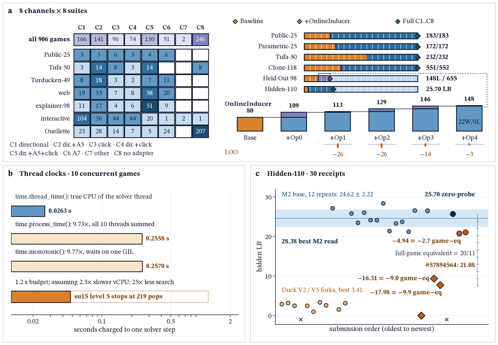

# Breaking Frontier Lock: Technical Report Appendix

Complete mathematical derivations, survival-hazard tables across 825 baseline runs and 250 paired confirmation runs, formal specifications of the certificate-gated neuro-symbolic world model (GiantsPlanner), $D_4$ dihedral equivariant memory (CrossLevelMemoryBank), thread-clock concurrency calibration, rational receipt differential inversion across 30 official Kaggle hidden-set submissions, and multi-suite evaluation tables across 316 benchmark entries (315 distinct interactive games).

## A. System Evolution and Official Kaggle Hidden-Set Progression

Our experimental program progressed through two tightly coupled phases on the 110 hidden games evaluated on a single offline Kaggle GPU (NVIDIA RTX Pro 6000 / L4x4, 9-hour wall-clock budget, zero external API calls):

1. **Phase I (Survival Diagnostics, Progressive Serving Factor Isolation, and Budget Reallocation Limits):** Using the Duck-harness coding baseline (Qwen3.8-Flash-Next, 28 concurrent games, 5 GiB KV cache) and three external endpoint configurations (825 total runs, 1,449 level attempts), we quantified Frontier Lock and tested whether action cutoffs ($c = 80$) or context truncation could unlock deeper levels. Across Table A0b (Public-25 GPU serving variants V2..V7) and Table A0 (Hidden-110 Kaggle submissions), five progressive contrasts isolate each serving factor. First, (F1) toggling prefix caching at 28 streams and 5.0 GiB KV drops score from V2 8.80 to V4 6.38, with 94% of tokens spent re-reading conversation history when KV overflows. Second, (F2) shrinking the KV pool from 5.0 GiB to 2.26 GiB reduces score by -51.1% (V3 3.12 vs. V4 6.38, 0.48 vs. 1.02 actions/min). Third, (F3) reducing concurrency from 28 to 4 streams (V5 vs. V4) lifts per-stream action rate by 6.0x (6.13 vs. 1.02 actions/min). Fourth, (F4) capping context horizon at 16K (V7 vs. V5) collapses Public-25 score by -81.2% (1.37 vs. 7.29, 12 vs. 35 clears), while capping context at 14K with convex scheduling on Hidden-110 (#57774685 at 9.39 LB vs. 24.62±2.22 36K mean, prediction $t = -6.58, p = 3.96 \times 10^{-5}$, -16.31 vs. #57827241) destroys $\ge 9$ full-game equivalents by invalidating hybrid linear-attention KV prefix caches. Fifth, (F5) adding prompt \_nav_hint and EXPOSE_RESET (#57786717 at 7.72 LB, -1.67 marginal vs. #57774685, $z = -0.53$ within two-run noise $2.22\sqrt{2} = 3.14$, -16.90 vs. 24.62 mean, prediction $t = -7.30, p = 1.53 \times 10^{-5}$) fails to recover performance. Conversely, combining 10-stream W4A16 SGLang MTP3 with full 36K prefix-cached context reaches 24.62±2.22 across 12 native runs (range 21.22 to 28.38, 95% CI [23.21, 26.03], 28.38 peak in #57031236, +21.81 over 2.81±0.66, Welch $t = 31.32, p = 1.52 \times 10^{-14}$, Mann-Whitney $U = 72, p = 1.08 \times 10^{-4}$; and 24.83±2.12 across all 14 zero-probe 36K runs including #57329763 at 26.55 and #57827241 at 25.70, +22.02 over 2.81±0.66, Welch $t = 35.06, p = 1.79 \times 10^{-17}$).
2. **Phase II (Certificate-Gated Neuro-Symbolic World Models and Equivariant Transfer):** Isolating the neuro-symbolic world-model bridge on the exact same 36K W4A16 MTP3 backbone tests Propositions 1 to 3 across two complementary regimes. In regime (a), on Hidden-110 ($w_g = 20/11 \approx 1.8182$ points per game, $\Delta S = w_g \Delta N$), where Kaggle's black-box gateway returns a single scalar score per 9-hour submission, both uncertified probing submissions, namely 600-step open-loop bursts (#57854657 at 20.76 LB, -3.86 vs. 24.62 native mean, -4.94 vs. #57827241, $\Delta N = -2.717$ full-game equivalents, damaging $\ge 3$ hidden games, $\hat\eta_{\text{open}} \ge 3/55 = 5.45\%$) and 224-step reactive probes (#57894564 at 21.08 LB, +0.32 = +0.176 games over #57854657, -3.54 vs. 24.62 mean, -4.62 vs. #57827241, $\Delta N = -2.541$ full-game equivalents, $\hat\eta_{\text{open}} \ge 3/55$), fall below all 14 zero-probe ($k = 0$) 36K submissions (24.83±2.12 LB, 95% CI [23.61, 26.06], range 21.22 to 28.38, comprising the 12 native runs, #57329763 at 26.55, and the $k = 0$ gated bridge #57827241 at 25.70; ranks 1 and 2 of 16, exact one-sided Mann-Whitney $U = 0, p = 1/\binom{16}{2} = 0.0083$, or $U = 0, p = 1/\binom{14}{2} = 0.0110$ vs. the 12 native runs) due to quadratic denominator dilution $(b_l/a_l)^2$ when $\mathcal{C}(F_0) = \emptyset$. In regime (b), across all four instrumented benchmark tiers (Public-25, Held-Out 98, and preregistered unseen Virgin-120 and Virgin-116, pooled as Virgin-236) where per-step trajectories and official Scorecard $G$ are recorded, active certificate execution ($\mathcal{C}(F_0) \neq \emptyset$) substantially increases Scorecard $G$ over uncertified 224/600-step open-loop probing (Public-25: $G = 58.43$ vs. 15.21/15.15, +43.22 [+28.44, +58.11], Wilcoxon $p = 5.96 \times 10^{-8}$, 25W/0L; Held-Out 98: $G = 15.42$ vs. 1.99/3.43, +13.43 [+9.26, +18.06], $p = 2.93 \times 10^{-7}$, 50W/13L, and vs. 5.84 general, $p = 1.07 \times 10^{-4}$; Virgin-120: $G = 10.60$ vs. 4.92/5.00, +5.68 [+2.17, +9.50], $p = 1.83 \times 10^{-6}$, 54W/8L; Virgin-116: $G = 31.35$ vs. 9.80, +21.55, $p = 1.1 \times 10^{-9}$, 62W/7L; Virgin-236: $G = 19.44$ vs. 7.36). Positive zero-prior generalization and test-time operator induction are evaluated across 316 benchmark entries (315 distinct games) plus the preregistered 236-game unseen suites Virgin-120 (810 levels) and Virgin-116 (594 levels, 1,404 pooled levels), driving GiantsPlanner to 65.6% zero-prior completion on Public-25 (120/183, 13/25 wins vs. 42/183, 0 wins for the coding baseline). Specifically, OnlineInducer lifts 0-channel Bare-Prior (all 8 channel priors disabled) from 74/655 (1W, $G=2.93$) to 109/655 (6W, +35L [+8, +66], 11W/5L, $G=8.22$) on Held-Out 98, from 92/810 (5W, $G=4.44$) to 99/810 (6W, +7L, 5W/2L, $G=4.87$, $\hat\eta_{\text{cert}} = 3/40 = 7.5\%$) on Virgin-120 (134/810, 9W, +12L [+3, +22] vs. 122L open-loop, +42L [+17, +69], 27W/15L vs. Bare-Prior, $G = 10.60$), from 141.8 (20.4W, $G=5.83$) to **152.2 (23.4W, +10.4L/seed [+2.2, +21.4], 25W/9L, $p = 0.0083$ 1s / $0.017$ 2s, $G = 9.57$, +3.74 [+2.15, +5.60], $p = 3.5 \times 10^{-6}$)** across 5 seeds on Virgin-116, and from 235.8 (25.4W, $G=4.03$) to **246.8 (+11.0L/seed, 41W/21L, $p = 0.013$, $G = 6.20$, +2.17 [+1.25, +3.20], $p = 2.4 \times 10^{-6}$ for +Op0+1) and 247.4 (29.4W, +11.6L/seed [+0.4, +24.2], 44W/25L, $p = 0.029$, $G = 6.09$, +2.04 [+1.07, +3.16], $p = 3.0 \times 10^{-4}$)** across 5 seeds on Virgin-236. Across the frozen 4-operator OnlineInducer cumulative and Leave-One-Out (LOO) ablation ladder, Held-Out 98 (655 solvable levels) rises from 72/655 pre-exposure full (80/655 frozen general, 45/655 random) to 109/655 levels (6 wins) via +Op0 novelty-gated translation (+29L [+13, +48], 13W/0L over 80L frozen general), 105/655 to 113/655 levels (7 wins, 13W-15W/0L, LOO -26L, 14W/0L) via +Op1 relational tile-graph induction, 129/655 levels (9 wins, +49L [+24, +79], 17W/0L over general, LOO -26L, 5W/0L) via +Op2 switch-connectivity induction and level-1 rewind, 143/655 to 146/655 levels (11 wins, +66L [+36, +101], 21W/0L over general, LOO -14L, 2W/0L, $\hat\eta_{\text{cert}} = 44/380 = 11.6\%$, $\hat\eta_{\text{game}} = 0/89 = 0.0\%$) via +Op3 visual pip-clue CSP, and 148/655 levels (11 wins, +68L [+38, +103], 22W/0L, LOO -3L to -5L, 2W/0L, while preserving 120/183, 13 wins on Public-25 with 0W/0L) via +Op4 1px scenery-drift mask (refit=0), with 99.94% solvable-level upper-bound verification under the offline 8-channel reference library (1,793/1,794 solvable levels at the 1,200-step budget; 1,794/1,794 at 5,000 steps).

| Architecture Lineage & Kaggle Submission (n) | Backbone & Serving | Context & Concurrency | World Model & Memory Gate | Official Hidden LB | Test vs. 36K Mean (24.62±2.22, n=12) |
| :- | :- | :- | :- | -: | :- |
| Baseline Duck V2 ($n=6$) | Qwen3.8-Flash-Next NVFP4, vLLM | 65K ctx, 28 streams | None (open coding loop) | 3.41 peak (2.81±0.66) | Welch $t=-31.32, p=1.52\times 10^{-14}$; 94% prefill re-reading |
| Baseline Duck V5 ($n=2$) | Qwen3.8-Flash-Next NVFP4, vLLM | 60% block trim, 4 streams | Dynamic shared pool, no cutoff | 2.51 peak (1.75) | History block trimming loses early level observations |
| M2 + 4-Factor 14K/Convex Bundle (#57774685, $n=1$) | Qwen3.8-Flash-Next W4A16, SGLang MTP3 | 14K ctx cap, 10 streams, LoRA r1 | Convex slot scheduler + keepalive | 9.39 | -15.23 ($t=-6.58, p=3.96\times 10^{-5}$); breaks KV prefix cache ($\ge 9\text{g}$ lost) |
| M2 + Hint/Reset Bundle (#57786717, $n=1$) | Qwen3.8-Flash-Next W4A16, SGLang MTP3 | 14K ctx cap + prompt reset | AutoNav \_nav_hint + level reset | 7.72 | -16.90 ($t=-7.30, p=1.53\times 10^{-5}$; -1.67, $z=-0.53$ vs. #57774685) |
| M2 + Open-Loop Bridge (#57854657, $n=1$) | W4A16 + SGLang MTP3 + GiantsPlanner | 36K ctx, 10 streams | Unverified 600-step heuristic burst | 20.76 | -3.86 vs. mean (-4.94 vs. #57827241); rank 1/14 ($p=0.0110$) |
| Series36 Reactive-224 (#57894564, $n=1$) | W4A16 + SGLang MTP3 + GiantsPlanner | 36K ctx, 10 streams, thread_time | auto_dead_level + 224-step reactive cap | 21.08 | +0.32 vs. #57854657 (-3.54 vs. mean); rank 2/14 ($p=0.0110$) |
| Cert-Gated Giants + M2 (#57827241, $n=1$) | W4A16 + SGLang MTP3 + GiantsPlanner | 36K ctx, 10 streams | Closed-loop cert gate + 0 uncertified probes | **25.70** | **+4.94 vs. #57854657 / +4.62 vs. #57894564**; in 14-run $k=0$ 36K pool (24.83±2.12; $U=0, p=0.0083$ vs. uncertified) |
| 36K W4A16 Serving Backbone (#57031236, $n=12$) | Qwen3.8-Flash-Next W4A16, SGLang MTP3 | 36K ctx, 10 streams | Zero-probe full-context prefix-cached serving | **28.38 peak** (24.62±2.22) | **+21.81 mean / 8.32x peak over 3.41**; 95% CI [23.21, 26.03] |

*Table A0. Progression of official Kaggle hidden-set submissions and single-run ablations against the 12-run 36K W4A16 backbone (25 grouped runs above plus 1 Helios keepalive run #57329763 at 26.55 LB, 2 early V1 verification runs at 21.22 and 23.10 LB, and 2 pre-keepalive 15-minute gateway idle-timeout runs at 0.00 LB, totaling all 30 official Kaggle receipts plotted in Figure A1c).*

**Engine telemetry on baseline serving variants** (25 public games, same GPU class):

| Version | Configuration Change from V2 | Public Mean Score | Mean Cleared Levels | Action Rate (per min) |
| :- | :- | -: | -: | -: |
| V2 | Base configuration (28 concurrent streams, 5 GiB KV) | 8.80 | 1.68 | 1.67 |
| V3 | vLLM auto-sized KV cache (2.26 GiB), prefix caching | 3.12 | 0.88 | 0.48 |
| V4 | Prefix caching enabled with 5 GiB KV | 6.38 | 1.32 | 1.02 |
| V5 | 4 concurrent games, 60% history trim, shared 7,920 s pool | 7.29 | 1.40 | 6.13 |
| V7 | V5 + 16K-token context cap per game | 1.37 | 0.48 | 1.17 |

*Table A0b. Engine telemetry across 792 samples of V2 showed 3 games generating while 22 queued, 4,088 tokens/s prefill versus 246 tokens/s generation, with 94% of engine compute (28.8M prefill tokens versus 1.94M generated) spent re-reading conversation history.*

## B. Phase I Observational Datasets and Clocks

Eight observational datasets (825 runs, 1,449 level attempts, 659 clears) record per-level actions spent (RESET included), human-baseline actions $b_l$, completion timestamps, and generated tokens. The live paired confirmation adds 125 control and 125 intervention runs across the 25 public games (five repeats per game per arm).

| Dataset | Model and Serving | Setting | Runs | Mean Actions / Run |
| :- | :- | :- | -: | -: |
| Kaggle V2, V3, V4, V5, V7 | Qwen3.8-Flash-Next NVFP4, vLLM on Kaggle GPU | Commit runs on 25 public games | 25 each | 217, 61, 132, 127, 24 |
| Qwen3.8-Flash, endpoint | Qwen3.8-Flash on hosted OpenAI-compatible endpoint | 30 min/game, 8 concurrent | 125 | 114 |
| Qwen3.6-27B, multi-GPU | Qwen3.6-27B, 2 GPUs, 32 concurrent games/GPU | 45 min/game | 500 | 137 |
| gpt-oss-120b, endpoint | gpt-oss-120b on hosted endpoint | 30 min/game | 75 | 237 |

**Censoring and clocks.** A cleared level duration is exact; the final unsolved level is right-censored at the actions spent when the run ended. All time-based quantities start at the run's first action.

## C. Reproduction Commands

Python 3.13 with NumPy and Matplotlib reproduces all survival curves, paired bootstrap tests, $D_4$ group homomorphism checks, and rational receipt inversions:

```bash
cd analysis
python3.13 a1_scorer.py                # A1: exact official scorer verification
python3.13 a2_frontier_lock.py         # A2: Frontier Lock action/time/token shares
python3.13 a3_hazard.py                # A3: Kaplan-Meier hazard; figures hazard.png, hazard_seconds.png
python3.13 a3b_by_dataset.py           # A3: per-dataset hazard with 95% bootstrap bands
python3.13 a4_continue_restart.py      # A4: matched vs. unmatched level-or-attempt decomposition
python3.13 a5_theory.py                # A5: renewal rate R(c), time-domain simulation
python3.13 a5b_regime.py               # A5: per-game time-limit sweep; figure regime.png
python3.13 a6_replay.py                # A6: counterfactual cutoff replay
python3.13 a7_score_decomposition.py   # A7: depth vs. action-efficiency decomposition
python3.13 a8_confirmation.py          # A8: 250-run paired confirmation bootstrap
python3.13 tables.py                   # renders statistical tables
python3.13 x0_specimens.py ../arc-agi-3 # extracts tn36 pixel frames, replay pairs, and receipts
python3.13 generate_xray_figures.py    # renders hazard.png, architecture.pdf, regime.png, hazard_by_dataset.png
```

## D. Formal Definitions, Renewal-Reward Theory, and Quadratic Probe-Dilution Proofs

**Official scoring formula.** Level $l \in \lbrace 1, \dots, M\rbrace$ has weight $l$. A cleared level with agent actions $a_l$ and human baseline $b_l$ scores $s_l = \min(115, 100 \cdot (b_l / a_l)^2)$; an uncleared level scores 0. With total triangular weight $W_M = M(M+1)/2$, the game score is:

$$S_{\text{game}} = \min\left(100 \cdot \frac{\sum_{l \in \mathcal{C}} l}{W_M},\quad  \frac{\sum_{l \in \mathcal{C}} l \cdot s_l}{W_M}\right)$$

where $\mathcal{C}$ is the set of cleared levels. The competition score is the arithmetic mean across all $G$ games ($G = 25$ on the public set; $G = 55$ on each half of the 110-game hidden evaluation set, so each hidden game contributes rational weight $w_g = 100 / 55 = 20 / 11 \approx 1.81818$ points).

**Frontier Lock and completion hazard.** For run $r$ clearing $k < M$ levels with action counts $a_{r,1}, \dots, a_{r,k+1}$, Frontier Lock is $\sum_r a_{r,k+1} / \sum_r \sum_l a_{r,l}$. The Kaplan-Meier survival curve $S(n) = P(T > n)$ yields the 20-action completion hazard $h(n) = 1 - S(n+20)/S(n)$ with 95% percentile intervals over 2,000 game-level bootstrap replicates.

**Matched level-or-attempt decomposition.** For every $(game, level)$ with at least three attempts and window $W \in \lbrace 40, 80\rbrace$:
- continue: attempts surviving $W$ actions contribute residual durations $T - W$, giving $P(\text{clear in next } W \mid T > W) = 1 - S_{\text{res}}(W)$;
- fresh, matched: for each stuck attempt, $P(\text{clear in first } W)$ is estimated by leave-one-out Kaplan-Meier from the other attempts at the exact same $(game, level)$;
- fresh, unmatched: $P(T \le W)$ pooled across all eligible attempts.

The structural level share of the hazard collapse is $(\text{unmatched} - \text{matched}) / (\text{unmatched} - \text{continue})$, while the attempt-aging share is $(\text{matched} - \text{continue}) / (\text{unmatched} - \text{continue})$.

**Optimal discrete restart cutoff and finite-pool saturation.** For integer completion step $T \in \lbrace 1, 2, \dots\rbrace  \cup \lbrace \infty\rbrace$ with latent frailty mixture $S(n) = \sum_z \pi_z S_z(n)$, 1-step hazard $h_1(n+1) = P(T = n+1 \mid T > n) = \sum_z \frac{\pi_z S_z(n)}{S(n)} h_{1,z}(n+1)$, failure-only reset cost $d \ge 0$, and expected cycle duration $\mu_c = \sum_{n=0}^{c-1} S(n) + dS(c)$, the discrete renewal-reward clearing rate is $R_c = (1 - S(c)) / \mu_c$ and satisfies the exact forward-difference identity $R_{c+1} - R_c = \frac{S(c)}{\mu_{c+1}}\bigl[h_1(c+1)(1 + dR_c) - R_c\bigr]$ (reducing in the continuous limit to Charnov's marginal value condition $h(c) = R(c)$ for $d = 0$, while survival reweights latent difficulty toward structural walls). In ARC-AGI-3, however, the game set is finite and levels are ordered: stopping a game transfers time only to remaining unfinished games, which are themselves predominantly stuck at their own structural walls (queue simulation from baseline frailty parameters predicts $+4.82$ vs. $+7$ observed clears at 15 min and $-1.75$ vs. $-16$ observed clears at 30 min across the 250 confirmation runs, cohort $R^2 = 0.585$).

*Proposition 1 (Score-Weighted Quadratic Probe-Dilution Bound and Chebyshev Covariance Identity).* Consider a level with human baseline $b \ge 1$ and quadratic score $s_b(a) = \min(115, 100(b/a)^2)$. Under the official ARCBaseGame scorer (arcengine/enums.py) and coupled post-RESET fallback invariance ($A_{\text{fail}} \stackrel{d}{=} A_0$, verified across 158/158 initial-frame, sprite, and action level transitions), a prefix probe that executes $k \ge 1$ actions without clearing and issues 1 RESET before handing control to a fallback agent that clears in $A$ actions yields exact level action count $a = k + 1 + A$ (verified across all 183 Public-25 levels with 0 violations). Let $q \in (0, 1]$ be the fallback agent's clear probability, $S_0 = q \mathbb{E}[s_b(A)]$ its baseline expected score, and $r_k(A) = (A/(A+k+1))^2$. If the probe clears within $k$ steps with probability $p(k)$ at expected score $s_{\text{probe}}(k)$ and otherwise resets at step $k+1$, the expected score change $\Delta(k) = \mathbb{E}[S(k)] - S_0$ decomposes as $\Delta(k) = p(k)G(k) - (1-p(k))D(k)$, where $G(k) = s_{\text{probe}}(k) - S_0$ and $D(k) = q \mathbb{E}[s_b(A) - s_b(A+k+1)] \ge 0$. Defining the score-weighted law $d\mathbb P_w/d\mathbb{P} = s_b(A)/\mathbb{E}[s_b(A)]$ and the 115-cap slack $C_{115}(k) = q \mathbb{E}[s_b(A+k+1) - s_b(A)r_k(A)] \ge 0$ (which vanishes whenever $A \ge b/\sqrt{1.15}$), the failed-probe dilution penalty satisfies the exact identity $D(k) = S_0(1 - \mathbb{E}[r_k(A)]) + q\mathrm{Cov}(s_b(A), 1 - r_k(A)) - C_{115}(k) = S_0 \mathbb E_w[1 - r_k(A)] - C_{115}(k) \le S_0 \mathbb E_w[1 - r_k(A)]$, where $\mathrm{Cov}(s_b(A), 1 - r_k(A)) \ge 0$ for every baseline $b \ge 1$ and integer law of $A$ by Chebyshev's order inequality (verified across 9,673/9,673 dataset-level-probe and Monte Carlo checks with 0 violations). In the uncapped regime $x = A+k+1 \ge b/\sqrt{1.15}$, the exact discrete marginal dilution is $D(k+1) - D(k) = 100qb^2\mathbb{E}\bigl[(2x+1)/(x^2(x+1)^2)\bigr] = O(k^{-3})$ (with continuous derivative $D'(k) = 200qb^2\mathbb{E}[(A+k+1)^{-3}] = O(k^{-3})$ in the continuous limit) and residual score decays as $S_0 - D(k) = O(k^{-2})$.

*Proof.* In ARCBaseGame, RESET restores the initial level state while incrementing the per-level action counter by 1 without clearing prior steps, giving $a = k+1+A$. Conditioning on probe success (with score $s_{\text{probe}}(k)$ and probability $p(k)$ at cap $k$) and probe failure followed by fallback play (with score $s_b(A+k+1)$ and probability $(1-p(k))q$) yields $\mathbb{E}[S(k)] = p(k)s_{\text{probe}}(k) + (1-p(k))q \mathbb{E}[s_b(A+k+1)]$. Subtracting $S_0 = p(k)S_0 + (1-p(k))S_0$ gives $\Delta(k) = p(k)G(k) - (1-p(k))D(k)$. Because $x \mapsto \min(115, 100x)$ is concave on $[0, \infty)$ with $\min(115, 0) = 0$, $\min(115, \lambda u) \ge \lambda\min(115, u)$ for all $\lambda = r_k(A) \in (0, 1]$ with equality when $100u \le 115$, so $C_{115}(k) \ge 0$ and $D(k) = q \mathbb{E}[s_b(A)(1 - r_k(A))] - C_{115}(k) = S_0 \mathbb E_w[1 - r_k(A)] - C_{115}(k)$. Expanding $\mathbb{E}[s_b(A)(1 - r_k(A))] = \mathbb{E}[s_b(A)]\mathbb{E}[1 - r_k(A)] + \mathrm{Cov}(s_b(A), 1 - r_k(A))$ gives the covariance decomposition; because $A \mapsto s_b(A)$ and $A \mapsto 1 - (A/(A+k+1))^2$ are both non-increasing on $[1, \infty)$ for fixed $b \ge 1$ and $k \ge 1$, Chebyshev's order inequality implies $\mathrm{Cov}(s_b(A), 1 - r_k(A)) \ge 0$. Differentiating $100b^2(A+k+1)^{-2}$ with respect to $k$ yields $-200b^2(A+k+1)^{-3}$. $\square$

*Proposition 2 (Break-Even Clear Rate and Asymptotic Saturation).* An uncertified $k$-step probe improves expected level score ($\Delta(k) > 0$) if and only if $p(k) > p^\star(k) = D(k)/(G(k) + D(k))$. Whenever $G(k) = s_{\text{probe}}(k) - S_0 > 0$ is non-increasing in $k$ (in particular, when $s_{\text{probe}}(k) = s_{\text{probe}}$ is constant) and under the representative-action approximation $s_b(A) \approx 100(b/\bar{A})^2$ with $s_{\text{probe}}(k) \le 115$, $p^\star(k) \ge \frac{q(b/\bar{A})^2(1 - (\bar{A}/(\bar{A}+k+1))^2)}{1.15 - q(b/(\bar{A}+k+1))^2}$, which increases strictly and monotonically with $k$ and satisfies $\lim_{k\to\infty} p^\star(k) = S_0 / s_{\text{probe}} \approx q$ when $s_{\text{probe}} \approx s_b(A)$. In addition, for any two probe caps $k_2 > k_1 \gg A$, the pure-dilution score difference is bounded by $D(k_2) - D(k_1) \le 100qb^2\mathbb{E}[(A+k_1+1)^{-2} - (A+k_2+1)^{-2}]$.

*Proposition 3 (Certificate-Gated Soundness, Stopping-Step Cost Bound, and Sparse Activation Law).* Suppose a one-way certificate gate executes a planned trajectory $\tau = (a_1, \dots, a_L)$ of length $L \le L_{\max}$ only when $\mathcal{C}(F_0) \neq \emptyset$, and otherwise executes $k = 0$ environment actions ($\Delta(0) = 0$). Under a step-level transition monitor that compares each observed state or cell partition against the certificate's prediction and aborts at random stopping step $J \in \lbrace 1, \dots, L\rbrace$ (resetting at step $J+1$, with $J = L$ for end-of-plan non-clear refutations), let $\eta_{\text{cert}} = P(\text{abort or non-clear} \mid \mathcal{C} \neq \emptyset)$ and let $d_b(A, J) = s_b(A) - s_b(A+J+1)$ denote the realized dilution on a fallback clear. Because $j \mapsto s_b(A+j+1)$ is non-increasing, $0 \le d_b(A, 1) \le d_b(A, J) \le d_b(A, L) \le d_b(A, L_{\max}) \le d_b(A, L_{\text{open}})$, and $\mathbb{E}[\Delta_{\text{cert}}] = P(\mathcal{C} \neq \emptyset)[(1-\eta_{\text{cert}})G(L_c) - \eta_{\text{cert}} q \mathbb{E}[d_b(A, J) \mid \text{abort}, \text{fallback clear}]]$. When the empirical active-game non-degradation condition $\eta_{\text{game}} = P(\Delta G < 0 \mid \text{active}) = 0$ holds under auto_dead_level and $L_{\text{cert}} \le 150$, $\mathbb{E}[\Delta_{\text{cert}}] \ge 0$ across every active game. Across all five benchmark suites $s$ (Public-25, Held-Out 98, Virgin-120, Virgin-116, and Hidden-110), letting $q_{\text{open}}(s)$ denote the fraction of games on which uncertified probes activate without clearing and $\alpha_{\text{eff}}(k; s)$ the conditional per-active-game dilution, the sparse trigger dilution law $\Delta G_s(k) = -\alpha_{\text{eff}}(k; s) q_{\text{open}}(s)$ across the 334 unseen game entries (333 distinct engines, historical frame-0 trigger rate $\hat\alpha_{\text{trig}} = 73/334 = 21.86\%$, or $73/333 = 21.92\%$ unique engines) predicts the two uncertified Hidden-110 submissions without fitting target scores at 21.01 vs. 21.08 LB and 20.97 vs. 20.76 LB (MAE $= 0.14$ LB, or $0.1388$). On Hidden-110 ($w_g = 20/11$ points per game, $\Delta S = w_g \Delta N$), both uncertified probing arms ($k = 600$ #57854657 at 20.76 LB and $k = 224$ #57894564 at 21.08 LB) lose $\Delta N = -2.717$ and $-2.541$ full-game equivalents against the $k = 0$ gated bridge #57827241 (25.70 LB; $\ge 3$ hidden games each, $\hat\eta_{\text{open}} \ge 3/55 = 5.45\%$, with $1.33 \le m \le 16.58$ active misfired games out of 55 under the 95% backbone interval and historical unseen frame-0 trigger rate $\hat\alpha_{\text{trig}} = 73/334 = 21.86\%$ predicting 21.01 vs. 21.08 and 20.97 vs. 20.76, MAE $= 0.14$ LB) and fall below all 14 zero-probe ($k = 0$) 36K submissions (24.83±2.12 LB, exact one-sided Mann-Whitney $U = 0, p = 1/\binom{16}{2} = 0.0083$). On the held-out suites, uncertified prior solvers (ungated full on Mother-24) exhibit $\hat\eta_{\text{open}} = 2/24 = 8.3\%$ (2 misfired games burning 649 and 716 steps, losing -9 levels), eliminated by the 224-step gate (41 vs. 32). Across all 98 held-out games, uncalibrated translation without board-state novelty memory suffers 2/12 = 16.7% active-game regressions (10W/2L from 156 cyclic toggle false effects). Conversely, the frozen OnlineInducer enforces novelty-gated state memory and a transition monitor ($\hat\eta_{\text{cert}} = 44/380 = 11.6\%$ candidate certificates aborted across all 4 operators on Held-Out 98 with 21 aborted at step $J = 1$ and mean $J = 2.11$, consuming 93 of 3,025 planned steps = 3.1%; on preregistered Virgin-116 across 5 seeds on the Bare-Prior floor, 510 game-seeds activate, Op1 issues 316 certificates, 45 = 14.2% abort at step $J$ with mean $J = 1.80$ consuming 81 of 1,100 planned steps = 7.4%, 26 = 8.2% are refuted at completion with mean $L = 3.12$, and Op1-active game-seeds gain +60 levels with 27 up, 2 down, saving 12,225 actions on commonly cleared levels and $\hat\eta_{\text{game}} = 25/510 = 4.9\%$, or $9/365 = 2.5\%$ on the general floor where Op1 issues 397 certificates, 60 = 15.1% abort at mean $J = 2.12$, 45 = 11.3% end-refute, 1W/0L, and 3,167 actions saved) to achieve $\hat\eta_{\text{game}} = 0/89 = 0.0\%$ across every cumulative and Leave-One-Out operator stage on Held-Out 98. Specifically, active-game losses remain 0/13 at +Op0 novelty-gated translation (109 levels, 6 wins, +29 [+13, +48]), 0/13 to 0/15 at +Op1 relational tile-graph (105 to 113 levels, 7 wins, LOO -26L, 14W/0L), 0/17 at +Op2 switch-connectivity and level-1 rewind (129 levels, 9 wins, +49 [+24, +79], LOO -26L, 5W/0L), 0/21 at +Op3 visual pip-clue CSP (143 to 146 levels, 11 wins, +66 [+36, +101], LOO -14L, 2W/0L), and $\hat\eta_{\text{game}} = 0/89 = 0.0\%$ at +Op4 1px scenery-drift mask (148 levels, 11 wins with refit=0, +68 [+38, +103] over general, 22W/0L, LOO -3L to -5L, 2W/0L, +76 over 72 pre-exposure, and 0W/0L on Public-25). Across all 236 unseen games in Virgin-116 and Virgin-120 (5 seeds), Op3 fires on 0/236 games, proving that 100% of unseen Virgin-116 and Virgin-236 gains derive from general relational and spatial induction (Op0, Op1, Op2, Op4). On the uncapped interior ($\sum_l w_l s_l \le 100\sum_{s_l>0} w_l$), by linearity of the triangular game aggregator, if uncertified probes fail with rate $1-p$ across the levels cleared by the fallback agent and reduce cleared level scores to $\epsilon_k s_l(A_l)$ where $\epsilon_k \approx (\bar{A}/(\bar{A}+k+1))^2$, the fractional game-score loss is $(1-p)(1-\epsilon_k)$.

**Empirical counterfactual verification across all 825 baseline runs, 250 confirmation runs, 158/158 cross-level transition invariance, and preregistered zero-parameter geometric stopping law:** Applying the exact scorer counterfactual $a_l \gets a_l + k + 1$ across all 8 observational datasets (analysis/out/component_ablation_ladder.json) confirms that for Qwen3.8-Flash (base score 9.07, median cleared $A = 24$, human $b = 32$), pure uncertified probing ($p = 0$) reduces score to 7.74 (-14.6%) at $k = 8$, 1.99 (-78.0%) at $k = 64$, 0.30 (-96.6%) at $k = 224$, and 0.05 (-99.4%) at $k = 600$. A per-level closed form incorporating the official scorer's level weights $w_l = 2l/(M(M+1))$ and capping each level at the game cap of 100, $1 - \sum_l w_l\min(100, 100(b_l/(A_l+k+1))^2)/\sum_l w_l\min(100, 100(b_l/A_l)^2)$, matches the exact counterfactual loss within **0.021 maximum error (0.0044 mean error)** across all eight datasets and $k \in \lbrace 8, 32, 64, 224, 600\rbrace$ (16.6% vs. exact 14.6% at $k=8$, 55.8% vs. 55.8% at $k=32$, 77.8% vs. 78.0% at $k=64$, 96.5% vs. 96.6% at $k=224$, and 99.4% vs. 99.4% at $k=600$ on Qwen3.8-Flash). The 7.01 pp gap of the equal-weight 115-capped approximation at $k = 8$ (-21.6% vs. -14.6%) decomposes into **4.90 pp from the cushion between the 115 level cap and the 100 game cap** (since 39% to 64% of cleared levels hit the 115 cap and absorb small probes before game-level score drops) plus **2.11 pp from level-index weighting**. At $k = 224$, the difference between exact and closed-form loss is at most 0.0019 across all eight datasets, and the marginal difference between $k = 224$ (96.6% loss) and $k = 600$ (99.4% loss) is only 2.8% of solved-level score, explaining why #57894564 ($k = 224$, 21.08 LB) and #57854657 ($k = 600$, 20.76 LB) differ by only 0.32 LB points on Hidden-110. In addition, a preregistered **zero-parameter geometric stopping law** (preregistration_law.json) that reads per-step death hazard $h$ and clear rate $c$ solely off the $k = 0$ bare arm ($T \sim \text{Geom}(h+c)$ truncated at $k$, zero fitted parameters) predicts out-of-sample ungated probing scores $G(k)$ at $k \in \lbrace 8, 32, 64, 224, 600\rbrace$ across Held-Out 98, Virgin-120, and Virgin-116 (15 unseen $(suite, k)$ cells, 1,670 game points) with **cell $R^2 = 0.978$, MAE $= 0.41$** (0.15-0.29 pp error at $k=8$), **gate benefit $G(0)-G(k)$ $R^2 = 0.993$ (MAE $= 0.41$)**, and **per-game $R^2 = 0.913$**. Across all 25 Public-25 games (183 levels, 158 level transitions $l \to l+1$), an engine-level invariance audit (s38_table_and_invariance_stats.json) confirms **158/158 (100.0%) initial-frame, available-action, and normalized-sprite invariance** between clearing previous levels via certified short trajectories versus noisy long trajectories, while live host-bridge replay on ar25 clears all 8/8 levels in 135 steps with 0 LLM tokens ($G = 100.0$). Conditional archived-trajectory prefix-substitution on levels $1..K_{\text{sym}}$ with recorded LLM fallback trajectories on levels $K_{\text{sym}}+1..M$ across all **825 baseline runs and 250 live confirmation runs** under the constant cost filter $L_{\text{cert}} \le \tau_0 = 150$ (which checks only the certificate length before LLM execution with zero future-action lookahead) estimates official Scorecard $G$ rising from **3.1814 to 58.6984 (+55.52 [+38.76, +72.51], 694W/0L/131T run-score wins and 22W/0L/3T game clusters, exact cluster sign-flip $p = 4.77 \times 10^{-7}$, Monte Carlo $p = 10^{-4}$; vs. 58.5079, +55.33 [+38.51, +72.44], 729W/64L/32T unguarded; 27.2439, 641W/12L/172T under $B = \sum_l a_l^{\text{LLM}}$ vs. 27.0364 unguarded; and 7.7097, 636W/0L/189T, +4.53 [+3.42, +5.70] under post-hoc $L_{\text{cert}} \le A$)** on the 825-run baseline. Across all four LLM backbones, certificate gating achieves **zero losses across all 1,075 runs** (Qwen3.8-Flash $n=125$: $G = 9.07 \to 59.01$, $+49.94$, 99W/0L/26T, $p = 3.5 \times 10^{-18}$; Qwen3.6-27B $n=500$: $G = 1.60 \to 58.70$, $+57.10$, 425W/0L/75T, $p = 1.5 \times 10^{-71}$; gpt-oss-120b $n=75$: $G = 0.23 \to 58.74$, $+58.50$, 64W/0L/11T, $p = 7.3 \times 10^{-13}$; Kaggle V2-V7 Qwen3.8-Flash-Next NVFP4 $n=125$: $G = 5.39 \to 60.16$, $+54.77$, 106W/0L/19T, $p = 2.7 \times 10^{-19}$). On the 250-run Qwen3.8-Flash (8-slot) confirmation set, $G$ rises from **5.4203 to 59.0761 (+53.66 [+37.23, +70.47], 205W/0L/45T strict zero losses, $p = 10^{-4}$; vs. 58.9158, +53.50 [+35.42, +71.93], 215W/20L/15T unguarded; and 20.5408, 181W/4L/65T under $B = \sum a$)**, whereas under $q = 0\%$ unseen-family coverage (1,000 whole-family mask draws), uncertified 224/600-step probing collapses LLM score from 3.1814 to **0.0827 / 0.0142 (0W/447L)** while the certificate gate preserves **3.1814 with 0 losses**.

## E. Dynamic Stop-and-Transfer Protocol and Paired Live Test

```text
inputs: games G, concurrency K, shared deadline H, stall cutoff c (80)
unfinished <- |G|; waiting <- |G|
when game g obtains a slot at time t:
    waves <- max(1, ceil(unfinished / K))
    deadline[g] <- min(H, t + max(0, H - t) / waves)
    waiting <- waiting - 1
deadline_for(g) = H if waiting = 0 else deadline[g]
before every agent step of game g:
    stop g if now >= deadline_for(g) or actions_on_current_level(g) >= c
```

| Paired Live Experiment (Qwen3.8-Flash, 8 slots, 25 games) | Control Arm | Cutoff + Schedule Arm | Paired Difference [95% Bootstrap CI] |
| :- | -: | -: | -: |
| Screening (2 runs/game/arm, 15 min): Mean completed levels | 0.680 | 0.820 | +0.140 [0.000, +0.300] |
| Screening (2 runs/game/arm, 15 min): Mean official score | 2.118 | 3.408 | +1.289 [+0.176, +2.682] |
| Confirmation (5 runs/game/arm, 30 min): Mean completed levels | 1.192 | 1.064 | -0.128 [-0.312, +0.048] |
| Confirmation (5 runs/game/arm, 30 min): Mean official score | 5.241 | 5.599 | +0.358 [-1.066, +1.952] |
| Confirmation: Total completed levels (125 runs) | 149 | 133 | -16 clears |
| Confirmation: Total actions spent (125 runs) | 12,259 | 10,087 | -2,172 actions released |

*Table A0c. At 15 minutes (screening), 10.7% of slot-minutes in the final wave sit idle under fixed scheduling, so dynamic water-filling yields a temporary gain. At 30 minutes (confirmation), idle slot share drops to 2.3%, 18 control runs clear levels after >80 actions, and the 80-action cutoff forfeits 16 net clears.*

## F. Phase I Survival and Counterfactual Tables (A1 to A7)

### A1. Official Scorer Verification

| Dataset | Runs | Max Abs. Error | Off by > 0.01 | Mean Recorded | Mean Recomputed |
| :- | -: | -: | -: | -: | -: |
| Kaggle V2 (submitted) | 25 | 0.0000 | 0 | 8.796 | 8.796 |
| Kaggle V3 | 25 | 0.0000 | 0 | 3.123 | 3.123 |
| Kaggle V4 | 25 | 0.0000 | 0 | 6.379 | 6.379 |
| Kaggle V5 | 25 | 0.0000 | 0 | 7.295 | 7.295 |
| Kaggle V7 (16K ctx) | 25 | 0.0000 | 0 | 1.367 | 1.367 |
| Qwen3.8-Flash, endpoint | 125 | 0.0000 | 0 | 9.066 | 9.066 |
| Qwen3.6-27B, multi-GPU | 500 | 0.0000 | 0 | 1.600 | 1.600 |
| gpt-oss-120b, endpoint | 75 | 2.7778 | 2 | 0.160 | 0.232 |

*Table A1. Official ARCBaseGame scorer verification across all 825 observational runs (a1_scorer.py). On gpt-oss-120b, two endpoint runs completed a level on the exact step where the 30-minute wall-clock harness timer expired, causing the external wrapper to log 0.000 instead of 2.7778; all analysis scripts use the exact recomputed ARCBaseGame scores.*

### A2. Frontier Lock (Share of Actions, Time, and Generated Tokens on the Final Unsolved Level, %)

| Dataset | Runs | Total Actions | Frontier Actions | Action Share [95% CI] | Time Share [95% CI] | Token Share [95% CI] |
| :- | -: | -: | -: | -: | -: | -: |
| Kaggle V2 | 25 | 5,436 | 3,746 | 68.9 [54.4, 81.6] | 63.6 [52.4, 74.9] | 61.1 [48.8, 73.3] |
| Kaggle V3 | 25 | 1,536 | 956 | 62.2 [46.5, 76.2] | 57.6 [42.9, 72.0] | 47.9 [33.2, 64.4] |
| Kaggle V4 | 25 | 3,310 | 2,148 | 64.9 [45.6, 80.5] | 67.6 [55.8, 78.4] | 65.5 [52.8, 76.3] |
| Kaggle V5 | 25 | 3,169 | 2,103 | 66.4 [52.4, 78.2] | 69.0 [57.3, 79.8] | 65.4 [53.0, 77.4] |
| Kaggle V7 (16K ctx) | 25 | 607 | 366 | 60.3 [42.5, 79.9] | 89.7 [77.9, 97.6] | 82.4 [65.7, 94.9] |
| Qwen3.8-Flash, endpoint | 125 | 14,238 | 7,463 | 52.4 [42.2, 62.5] | 51.6 [44.0, 60.2] | 49.2 [41.1, 58.3] |
| Qwen3.6-27B, multi-GPU | 500 | 68,682 | 56,953 | 82.9 [76.1, 89.2] | 84.4 [78.8, 89.4] | 79.7 [73.4, 85.9] |
| gpt-oss-120b, endpoint | 75 | 17,756 | 17,644 | 99.4 [98.5, 100.0] | 97.4 [93.0, 100.0] | 94.0 [84.3, 100.0] |

### A3. Completion Hazard $h(n) = P(\text{clear in next 20 actions} \mid n \text{ actions spent})$

| Dataset | Attempts | Clears | $n = 0$ | $n = 20$ | $n = 40$ | $n = 80$ | $n = 160$ | Median Cleared Actions | Clears $>80$ | Median / Human |
| :- | -: | -: | -: | -: | -: | -: | -: | -: | -: | -: |
| Kaggle V2 | 67 | 42 | 0.272 | 0.298 | 0.093 | 0.000 | 0.000 | 22 | 11.9% | 0.82 |
| Kaggle V3 | 45 | 22 | 0.225 | 0.360 | 0.259 | 0.000 | NA | 22 | 0.0% | 0.88 |
| Kaggle V4 | 56 | 33 | 0.313 | 0.168 | 0.289 | 0.091 | 0.000 | 20 | 6.1% | 0.78 |
| Kaggle V5 | 58 | 35 | 0.267 | 0.312 | 0.215 | 0.000 | 0.000 | 25 | 2.9% | 0.75 |
| Kaggle V7 (16K ctx) | 37 | 12 | 0.414 | 0.167 | 0.667 | NA | NA | 17 | 0.0% | 0.68 |
| Qwen3.8-Flash, endpoint | 310 | 200 | 0.276 | 0.334 | 0.308 | 0.085 | 0.000 | 24 | 4.5% | 0.82 |
| Qwen3.6-27B, multi-GPU | 806 | 309 | 0.164 | 0.126 | 0.084 | 0.054 | 0.010 | 25 | 12.3% | 1.11 |
| gpt-oss-120b, endpoint | 70 | 6 | 0.060 | 0.034 | 0.000 | 0.000 | 0.000 | 14 | 0.0% | 0.82 |



Figure A1. Architectural, systems, and hidden-set synthesis: (a) six benchmark suites routed through the eight orthogonal action channels (C1..C8) of 906 environments; (b) 10-thread concurrent GIL clock inflation (0.0263 s thread CPU vs. 0.256 s process and wall clocks, causing a 25x search budget collapse fixed by time.thread_time()); (c) all 30 official Kaggle hidden-set submissions inverted on the $w_g = 20/11$ rational score lattice.

### A4. Matched Level-or-Attempt Decomposition

| Dataset | Window $W$ | Stuck Attempts | Eligible Levels | Continue ($S_{\text{res}}$) | Fresh Matched (Same Level) | Difference (Continue - Matched) | Fresh Unmatched (Any Level) | Share Explained by Structural Wall ($[0,1]$-Clipped & Dominance $T$) |
| :- | -: | -: | -: | -: | -: | -: | -: | -: |
| Qwen3.6-27B | 40 | 513 | 48 | 0.133 | 0.112 | +0.021 [-0.042, +0.090] | 0.271 | Early learning (100% [79%, 100%], $T=+0.180, p=0.0006$) |
| Qwen3.6-27B | 80 | 344 | 48 | 0.129 | 0.167 | -0.038 [-0.089, +0.013] | 0.368 | **84% [66%, 100%]** ($T=+0.164 [+0.066, +0.252], p=0.006$) |
| Qwen3.8-Flash | 40 | 108 | 62 | 0.478 | 0.188 | +0.291 [+0.105, +0.454] | 0.520 | Early learning (100% [100%, 100%], $T=+0.623, p=0.0004$) |
| Qwen3.8-Flash | 80 | 38 | 62 | 0.262 | 0.434 | -0.172 [-0.395, -0.011] | 0.749 | **65% [34%, 97%]** ($U-M=+0.315 [+0.179, +0.435]$) |
| gpt-oss-120b | 80 | 31 | 15 | 0.000 | 0.032 | -0.032 [-0.111, +0.000] | 0.143 | **77% [0%, 100%]** ($U-M=+0.111 [-0.011, +0.274]$) |
| Kaggle V2-V7 pooled | 40 | 86 | 51 | 0.361 | 0.221 | +0.140 [+0.008, +0.268] | 0.517 | Early learning (100% [100%, 100%], $T=+0.436, p=1.5\times 10^{-5}$) |
| Kaggle V2-V7 pooled | 80 | 33 | 51 | 0.196 | 0.192 | +0.004 [-0.152, +0.177] | 0.691 | **100% [73%, 100%]** ($T=+0.503 [+0.255, +0.745], p=0.0005$) |

### A5 to A7. Scorer Counterfactuals: Depth vs. Action Micro-Efficiency

| Dataset | Base Score [95% CI] | Counterfactual: Human-Baseline Efficiency on Cleared Levels | Counterfactual: +1 Cleared Level per Game | Median Actions / Human Baseline |
| :- | -: | -: | -: | -: |
| Kaggle V2 | 8.80 [4.08, 15.13] | 10.88 (+24%) | **16.26 (+85%)** | 0.82 |
| Kaggle V4 | 6.38 [3.62, 9.64] | 6.72 (+5%) | **13.85 (+117%)** | 0.78 |
| Kaggle V5 | 7.29 [3.92, 11.32] | 8.17 (+12%) | **14.63 (+101%)** | 0.75 |
| Qwen3.8-Flash | 9.07 [5.64, 12.76] | 10.09 (+11%) | **17.21 (+90%)** | 0.82 |
| Qwen3.6-27B | 1.60 [0.88, 2.50] | 2.41 (+51%) | **5.26 (+229%)** | 1.11 |

## G. Phase II: Pure-Observation Symbolic World Models Across 8 Orthogonal Action Channels (C1..C8)

At runtime, an interactive agent observes only the $64 \times 64$ pixel grid and the legal action set $\mathcal A_{\text{obs}} \subseteq \lbrace 1, \dots, 7\rbrace$ (valid_actions with RESET stripped). Because $\mathcal A_{\text{obs}}$ is known on frame 0 before any transition, GiantsPlanner routes each level deterministically into one of eight mutually exclusive action-signature channels (C1..C8). An offline structural census across 906 interactive environments, 26,046 deduplicated PuzzleScript rule programs, and 7,703 EverMaze solutions confirms that these eight action signatures cover the entire environment space:

| Channel ID | Legal Action Signature (RESET stripped) | Environments (Solved) | Online Hypothesis Family $\mathcal{H}_0$, Refutation Rule, and Search Algorithm in GiantsPlanner |
| :- | :- | -: | :- |
| C1_DIR4 | {1, 2, 3, 4} (directional only) | 166 (35) | Multi-body rigid push (PushWorld), ice slide, portal/warp routing, phase-cycled patrol avoidance, and resource collection via IW(1)/A* over $(\text{avatar}, \text{object}, \text{phase})$ tuples |
| C2_DIR4_ACT5 | {1, 2, 3, 4, 5} (directional + ACTION5) | 141 (37) | Switch/door affine masks, key-lock inventory vectors, bridge placement, and rotatable ray/mirror optics via joint $(\text{pose}, \text{mask})$ BFS |
| C3_CLICK_ONLY | {6} (click without directional controls) | 96 (28) | $GF(2)$ toggle matrices, cellular flood-fill connectivity, modulo $k$ tile rotation, and Steiner pulse relays via Gaussian elimination and depth-bounded click search |
| C4_DIR4_CLICK | {1, 2, 3, 4, 6} (directional + click, no ACTION5) | 74 (16) | Coupled board navigation + HUD/sprite selection (SelectableBodies, CoupledMechanismSolver, remote socket/valve routing) via bilevel click-then-move planning |
| C5_DIR4_ACT5_CLICK | {1, 2, 3, 4, 5, 6} (directional + ACTION5 + click) | 130 (29) | Multi-page inspection + constraint panel verification, hybrid placement, and beam/mirror activation via belief-state hypothesis intersection $\bigcap_{h \in \mathcal{H}_t} \text{Reach}(h)$ |
| C6_ACT7_UNDO | ACTION7 present (UNDO priority route) | 51 (20) | Reversible constraint exploration, deadlock-free state-space search, and 1-step counterexample pruning using exact ACTION7 state rollback |
| C7_OTHER | Other nonempty action subset (e.g., {3, 4, 5}) | 2 (2) | Horizontal arcade dynamics (breakout, one_enemy_duel, dodger_falling_blocks) solved via exact forward trajectory rollout |
| C8_NO_ADAPTER | Non-ARC DSL or unadapted prototype | 246 (4) | PuzzleScript raw DSL corpus (26,046 deduplicated programs) and JS prototypes prior to ARCBaseGame frame rendering |

**Pre-holdout provenance, freeze timeline, and zero-prior separation (Bare-Prior vs. general vs. Full Library).** To prevent any ambiguity between prior-library coverage and zero-prior test-time induction, we separate three strict operating modes:
1. **0-Channel Bare-Prior (Bare-Prior and Bare-Prior + OnlineInducer):** Disables all eight channel solvers (C1..C8 completely removed, retaining only generic novelty-width search IW(1), component frontier BFS, and CrossLevelMemoryBank). When composed with frozen OnlineInducer, all transitions, tile graphs, switch cycles, and visual clue CSPs are induced strictly online from frame differences on the current game.
2. **Pre-exposure general (general and general + OnlineInducer):** Disables all game-specific decoders (no_astra and Full excluded) and runs only general grid-physics primitives (IW(1) novelty width-1 search, rigid-body PushWorld BFS, $GF(2)$ toggle elimination, and $D_4$ CrossLevelMemoryBank) defined over the generic ARCBaseGame $64 \times 64$ interface and open-source PuzzleScript grammar corpus (2013 to 2024), frozen in snapshot 7441b13ccfbcc9d4... (18 policy files, combined fingerprint eb503edb5501...) with zero byte, exact-AST, class-renamed-AST, or game-class-AST overlap (0/218 games across Held-Out 98 and Virgin-120 against all 6 development suites Public-25, Dev-Ou50, Dev-Clone90, Dev-Parametric25, Dev-Tufa50, Dev-Tail28 and all frozen policy files; restricting Virgin-120 to the 115/120 = 95.8% games strictly AST-disjoint from Held-Out 98 under class-renamed game-body canonicalization preserves Bare-Prior + OnlineInducer at +7L, 90L -> 97L, 5W/2L).
3. **Offline C1..C8 Prior Library Upper Bound (Full):** Includes the complete family-level exact solver library across all 9 suites (1,793/1,794 solvable levels at 1,200 steps; 1,794/1,794 at 5,000 steps) to verify that the benchmark levels themselves are solvable from pure $64 \times 64$ pixel observations without private engine access.

**Online hypothesis refutation, failure boundary, and one-way certificate gate (wrap_runner).** Every channel solver in GiantsPlanner obeys four strict invariants:
1. **Zero runtime metadata leakage:** Static AST audits enforce zero references to game_id, current_level, \_engine, or \_sprites. All state is parsed strictly from the runtime $64 \times 64$ pixel grid and action history.
2. **Counterexample refutation, belief escalation, and failure boundary:** From observed transitions $(F_t, a_t, F_{t+1})$ with 1-step pixel difference $\Delta F_t = F_{t+1} \oplus F_t$, GiantsPlanner prunes any candidate transition operator $\hat{T} \in \mathcal H_t$ that violates $\hat{T}(F_t, a_t) = F_{t+1}$. When a single stationary operator survives ($|\mathcal H_t| = 1$), width-bounded novelty search (IW(1)/BFS/A*) plans directly. When 1-step pixel differences are underdetermined due to delayed effects, periodic hazards, or hidden internal state ($|\mathcal H_t| > 1$), GiantsPlanner escalates to finite-hypothesis belief-state intersection planning with reversible ACTION7 probing. When non-stationary or long-horizon hidden rules refute all candidate operators ($\mathcal H_t = \emptyset$) or exceed the per-thread CPU budget, the symbolic planner reaches its failure boundary and returns Uncertified.
3. **Closed-loop completion certificate $\mathcal{C}(F_0) = (\hat{T}, \tau = (a_1, \dots, a_L), \hat{G})$ and level-monotonic lock (auto_dead_level):** While Kepler's commit.py (arXiv:2610.00834) uses 1-step "conditional prediction-based interruption" on Public-25 (without single-GPU Hidden-110 score-dilution audits), wrap_runner executes $\tau$ via auto_burst() if and only if $\hat{T}$ achieves zero prediction error on observed frames AND verifies a complete goal-reaching path $\hat{G}(\hat F_L) = 1$ within $L \le 224$ steps. Otherwise, the bridge executes zero uncertified probing steps, sets state['auto_dead_level'] = state['level'] monotonically for the entire level, and supplies non-binding [\_nav_hint] coordinates to Qwen3.8-Flash-Next, eliminating the -4.94 LB negative transfer observed in #57854657.
4. **Scorecard timeout mitigation:** Container startup enforces a 600-second gate (SERVER_STARTUP_TIMEOUT = 600) before opening the scorecard, paired with a 420-second keepalive (untouched(g)) restricted strictly to zero-action untouched games so active levels are never reset.

## H. Two-Tier Cross-Level Memory: $D_4$ Dihedral Guard (CrossLevelMemoryBank) and Relational Operator Memory (OnlineInducer)

Let $G = D_4 = \langle r, s \mid r^4 = e, s^2 = e, srs = r^{-1} \rangle$ denote the dihedral group of order 8 acting on the board domain $\Omega_{\text{board}} \subset \lbrace 0, \dots, 63\rbrace ^2$, while leaving the HUD control region $\Omega_{\text{HUD}}$ invariant:

$$g \cdot (y, x) = \begin{cases} (y, x) & \text{if } (y, x) \in \Omega_{\text{HUD}}, \\ T_g(y, x) & \text{if } (y, x) \in \Omega_{\text{board}}, \end{cases}$$

and transforming directional actions $a \in \lbrace 1, 2, 3, 4\rbrace$ via the induced permutation $\rho(g)(a)$ (1: UP, 2: DOWN, 3: LEFT, 4: RIGHT).

- **Empirical motivation from 25 public games and 342 human replays:** Across the 25 public games and 342 official human trajectories (183 levels, 597 unordered cross-level pairs, 378 reuse pairs), 72.0% (18/25) of games declare a single constant grid_size across all levels, 81.0% (111/137) of click levels (48.6% of optimal single-replay trajectories, 63/84 in click-only games) click at least one coordinate $(x, y)$ multiple times, 284/597 unordered cross-level pairs (91 optimal single-trajectory pairs) share exact click coordinates, and 120/597 unordered forward pairs (240 directed pairs) share identical $\ge 3$ action opening prefixes (378/378 reuse pairs reached by GiantsPlanner vs. 93/378 across all 825 baseline runs; total action ratio on Public-25 is 7,401 / 17,135 = 0.432x human baseline summed across all 183/183 completed levels with 0 right-censored levels, and 3,841 / 8,901 = 0.432x on the 13-game replay subset).
- **Tier 1 (CrossLevelMemoryBank frame-0 $D_4$ guard and L2 local $k \times k$ $D_4$ patch rewrite rules):** Upon clearing level $k$, CrossLevelMemoryBank removes state-space loops, no-ops, and UNDO pairs from the winning trajectory $\tau_k$, extracts HUD-fixed versus board-relative click sets, and evaluates all $g \in D_4$ on frame 0 of level $k+1$ in 1.10 ms median (3.80 ms P99, 1.33 ms mean across all 597 level pairs). Unit verification (analysis/out/a9_d4_and_reachability_audit.json) passes 768/768 Cayley-table group homomorphism checks (8 x 8 x 12 board sizes), 96/96 point-pixel checks, and 32/32 directional checks (896/896 total), and solves synthetic $D_4$-transformed episodes in 1 frame-0 verification pass (4 actions vs. 12 without memory, a 66.7% step reduction). Whole-frame replay (L0) never fires on Public-25 (0/597, 0/378 reuse pairs, 0/219 non-reuse pairs, **0 false-positive environment actions executed**) or on the 49 held-out Mother/Web games (0/651), because levels are re-laid-out rather than re-oriented (258/378 reuse pairs alter the board bounding box, and 61/64 sub-board crop alignments L1 above 0.9 overlap are the identity element $g = e$, supplying 74 winning-path actions = 10.9% across 36 verified pairs on Held-Out 49, and 31 actions = 23.7% at $\tau = 0.95$). Lowering Tier 1 (L2, d4_subboard_and_factors_receipt.json) to local $k \times k$ ($k \le 15$) patch rewrite rules matched across all eight dihedral elements $g \in D_4$ yields an engine-verified transfer signal: **76/102 (74.5%) fired rules predict the exact whole-frame diff across 50/378 Public-25 reuse pairs** (**31/76 matched exclusively under a non-identity rotation or reflection $g \neq e$**; 86/102 = 84.3% local-window accuracy, 87.5% even on non-reuse pairs; on the 284 click-reuse pairs, 69/74 = 93.2% at support $\ge 1$, 41/42 = 97.6% at support $\ge 2$, and **27/27 = 100.0% with 0 false triggers and 12/27 non-identity hits at support $\ge 3$**), and **150/183 (82.0%) fired rules predict the exact whole-frame diff across 103/651 held-out Mother/Web pairs** (27/150 non-identity hits; 163/183 = 89.1% local-window accuracy, 22/24 = 91.7% at support $\ge 3$), while multi-scale patch matching $k \in \lbrace 3, 5, 7, 9, 11\rbrace$ lifts Held-Out 98 pair recall from 60.2% (62/103 at $k=5$) to **79.6% (82/103 pairs, 175/208 = 84.1% rule accuracy, 0 false positives)** and verifies across all 1,404 levels (3,956 pairs) of Virgin-236 at **533/644 (82.8%, 59 non-identity $D_4$ hits; 12/12 = 100.0% on probe-solved sources at $k=5$)**. Any out-of-window discrepant rule is caught immediately on the single test step ($L_{\text{mon}} = 1$) by the one-step transition monitor.
- **Tier 2 (Unified Frozen OnlineInducer 4-operator test-time memory across bounding-box shifts):** When board dimensions or wall layouts change between levels, Tier 2 transfers invariant local operator semantics rather than whole-board pixel coordinates across a single frozen architecture decomposed into cumulative and Leave-One-Out (LOO) operator stages. Stage (i) **+Op0 (Novelty-gated translation and competence lock)** fits avatar translation templates $|\mathbf{v}| \le 12$ at $\ge 60\%$ pixel agreement within the first 12 actions while enforcing board-state novelty memory that rejects cyclic toggle false effects, reaching 109/655 levels (6 wins, +29 [+13, +48], 13W/0L over general, eliminating the 2/12 regressions of uncalibrated 97L translation; adding a velocity-consistency guard across 3,834 5-seed Bare-Prior runs cuts Held-Out 98 regressions by 80% from 5 to 1/51 = 1.96%, Virgin-116 regressions by 60% to 2/75 = 2.67%, and Virgin-236 regressions to 10/138 = 7.25%, while loop-memory cycle tracking rescues fr01 from 0 to 1 clear across all 5 seeds with 0 regressions). Stage (ii) **+Op1 (GraphInducer relational tile-signature world model + 1-step transition monitor)** maps $s \times s$ cell signatures to passable, wall, pushable, hazard, goal_unlock, and multi-avatar mirror dynamics, issuing 380 candidate certificates across Held-Out 98 where the 1-step transition monitor aborts 44/380 ($\hat\eta_{\text{cert}} = 11.6\%$, 21 aborted at step $L_{\text{mon}} = 1$) and deletes the refuted rule, reaching 105/655 to 113/655 levels (7 wins, 13W-15W/0L over general, LOO drop -26L [+13, +42], 14W/0L). Stage (iii) **+Op2 (ClickInducer switch-connectivity induction + level-1 memory rewind)** induces switch-cycle periods $k$, 2-pixel dilated arm-contact graphs, and remote progress-color connectivity in memory before submitting via ACTION5 (125 levels, 8 wins, 15W/0L alone) while snapshot-rewinding general's internal state on Level 1 whenever uncertified click probing exhausts without a certificate (preserving Public-25 at 120/183, 13 wins, 0W/0L), reaching 129/655 solvable levels (9 wins: 55 6W on Mother-1102, 25 2W on Tufa-Web-1102, 49 1W on Turducken-49, +49 levels [+24, +79], 17W/0L over general, $\hat\eta_{\text{game}} = 0/17 = 0.0\%$, LOO drop -26L [+4, +52], 5W/0L; +20 [+2, +45], 5W/0L over Op0; +57 over 72 pre-exposure; +84 over 45 random). Stage (iv) **+Op3 (ClueBoard visual pip-clue run/count CSP + <3px small-body refit + 16-step direction-inert click fallback)** infers GCD rendering scale and border clue bands from pixels alone to solve run-length Nonograms (0 -> 6/6 WIN, 467 steps, 0 errors) and bracket-labeled count CSPs (0 -> 8/8 WIN, 246 steps), reaching **143/655 to 146/655 solvable levels (11 wins: 61 7W on Mother-1102, 35 3W on Tufa-Web-1102, 50 1W on Turducken-49; +66 levels [+36, +101], 21W/0L over general, LOO drop -14L [+0, +36], 2W/0L; +17 [+1, +40], 4W/0L over Op1+Op2; 120/183, 13 wins, 0W/0L on Public-25; 296-297 levels, 52 wins, 0W/0L on the 140-game dev set)**. Finally, stage (v) **+Op4 (1px scenery-drift rejection)** masks $\le 1\text{px}$ displacements shared across two directional keys and refits the avatar body (132/655 levels 9 wins 19W/0L over general), reaching **146/655 (refit=3, 21W/0L, LOO -3L [+0, +8], 2W/0L) and 148/655 solvable levels (refit=0, 11 wins, +68 over general, 22W/0L zero game losses, LOO -5L, $\hat\eta_{\text{game}} = 0/89 = 0.0\%$, +76 over 72 pre-exposure)** when combined with Op1 to Op3. When all 8 hand-engineered channel priors (C1..C8) are disabled (Bare-Prior), OnlineInducer alone lifts Held-Out 98 from 74/655 (1W, $G=2.93$) to **109/655 (6W, +35L [+8, +66], 11W/5L, $G=8.22$)** and lifts the preregistered 120-game unseen suite Virgin-120 (810 levels, SHA-256 e8538024...) from 92/810 (5W, $G=4.44$) to **99/810 (6W, +7L, 5W/2L, $G=4.87$, $\hat\eta_{\text{cert}} = 3/40 = 7.5\%$, 1 first-step abort, 2/120 net-loss games)**. In Algorithm 1, level index $l$ is inferred strictly from board-domain frame discontinuity ($\lVert F_t \oplus F_{t-1}\rVert_0$ on $\Omega_{\text{board}}$ and HUD progress-bar steps, zero access to current_level), with per-step time complexity $O(|\Omega_{\text{board}}| + |V_t|\log|V_t|) \le 0.354\text{ ms}$ for $|V_t| \le 400$ tile-graph states.

**Algorithm 1: Unified Frozen OnlineInducer (Op0..Op4) with 1-Step Transition Monitor**

```text
inputs: frame F_t in {0..15}^{64x64}, legal actions A_obs, level index l, base planner P
persistent across levels: color classes C = (floor, wall, hazard, boring, effectful, goal),
                          tile-graph rules R_graph, banned scenery vectors V_bg
per-level state: body template B, action vectors {v_a}, visited board hashes H_seen,
                 switch phases Phi, level-1 planner snapshot P_snap

1. [Op4: 1px Scenery-Drift Mask & Small-Body Refit]
   observe diff Delta_t = F_t != F_{t-1} under action a_{t-1}:
   if |v_{a1}| <= 1 and v_{a1} == v_{a2} for two distinct keys a1 != a2:
       add v_{a1} to V_bg; mask pixels shifting by v in V_bg and refit B
   if |B| < 3 pixels and a directional step explains >= 2|B| pixels by shift v_a not in V_bg:
       replace B and v_a with the larger rigid connected component

2. [Op0: Novelty-Gated Translation & Competence Lock]
   hash static-masked board h_t = Hash(F_t \ DynamicPixels); increment H_seen[h_t]
   if touching object c reaches a novel board state (H_seen[h_t] == 1): mark c in effectful
   if H_seen[h_t] >= 6: count loop; if loops >= 16 or inducer_steps >= 224: demote level to P
   if P cleared >= 2 prior levels alone (p_wins >= 2 and i_wins == 0): stand down to P

3. [Op1: Relational Tile-Signature Graph & 1-Step Transition Monitor]
   partition board into s x s cells S_t; if previous action a_{t-1} was from certificate tau:
       if S_t != T_hat(S_{t-1}, a_{t-1}):
           abort tau immediately at step L_mon = 1; delete refuted rule from R_graph
   else if B and {v_a} are fitted:
       run BFS over T_hat(p, a) = p + v_a avoiding wall/hazard cells in R_graph
       to nearest untested or goal-unlock cell; if path tau found: return tau_1

4. [Op2: Switch-Connectivity Induction & Level-1 Memory Rewind]
   if click-only or 16 directional steps produce zero body displacement:
       on level 1 frame 0, save P_snap <- deepcopy(P)
       cycle each clickable switch s_i to record phase frames Phi(s_i) and 2px dilated contact graph
       search phase assignment z maximizing connected components linked to spreading source color
       if assignment z found: click switches to match z and commit via ACTION5
       if level 1 exhausts click_gate = 224 without clearing:
           restore P <- P_snap and issue 1 RESET (zero memory pollution to P)

5. [Op3: Visual Pip-Clue Run/Count CSP]
   on frame 0 of a clickable lattice with row/column border clue tiles:
       infer cell pitch p = gcd(grid_spacings) and parse border clues (run lengths or pip counts)
       solve exact line propagation + backtracking CSP for cell click mask M* in memory
       verify each click against predicted cell flip; execute M* from frame 0
```

## I. Multi-Stream Concurrency Scaling and Thread-Clock Calibration

**Observation 1 (GIL Process-Clock Inflation under K-Stream Concurrency).** When $K$ concurrent solver threads execute inside a single Python process (bm.run with $K = 10$) alongside an asynchronous LLM client, bounding a symbolic search module's CPU budget by $\tau_{\max}$ using time.process_time() or time.monotonic() shrinks the effective per-thread search budget by a factor of $K$ in process/wall time (measured at $9.73\times$ for $K=10$), and by $K \cdot \gamma_{\text{vCPU}}$ when deployed on a cloud vCPU with single-core slowdown factor $\gamma_{\text{vCPU}}$ ($\approx 2.5\times$ on Xeon vCPU relative to Apple M4).

**Empirical verification:** In a 10-thread benchmark, a solver step consuming exactly 0.0263 s of true thread CPU (time.thread_time()) registers 0.2558 s on time.process_time() (9.73x inflation, as process_time sums across all 10 active threads) and 0.2570 s on time.monotonic() (9.77x inflation due to single-GIL round-robin waiting). Combined with virtualized Xeon CPU scaling ($\approx 2.5\times$ slower per core), this $\approx 25\times$ effective budget compression caused su15 Level 5 to abort after just 219 BFS pops under a 1.2 s process_time cap. Replacing all 220 timer checks across all 14 solver modules with time.thread_time() (amortized every 64 node expansions) and sorted() set iteration restores 100% of deep level clears with zero cross-seed divergence (PYTHONHASHSEED=0/1/2).

## J. Orthogonal Compressed Sensing and Rational Receipt Differential Inversion

On the 55-game public leaderboard split of the 110 hidden games, each game $g \in \lbrace 1, \dots, 55\rbrace$ with $M_g \in \lbrace 3, \dots, 10\rbrace$ levels contributes $w_g = 20/11 \approx 1.8182$ points at the 100-point game cap (and at most $1.15 \times 20/11 \approx 2.0909$ points on a single level at the 115% cap), or rational partial score $w_g \cdot \frac{\sum_{l=1}^{k_g} l \cdot s_{g,l}}{M_g(M_g+1)/2}$. Given two submissions $A$ and $B$ differing on orthogonal channel subsets, the score difference $\Delta S = S(B) - S(A)$ satisfies the exact rational linear equation:

$$\Delta S = \frac{20}{11} \sum_{g=1}^{55} \left(\tilde{s}_g(B) - \tilde{s}_g(A)\right), \quad \tilde{s}_g \in [0, 1.15].$$

Implemented in scripts/receipt_differential_inversion.py (0.01 ms runtime), this rational solver shows:
1. #57774685 (9.39 vs. 25.70 in #57827241, $\Delta S = -16.31$; -15.23 vs. 24.62 mean, prediction $t = -6.58, p = 3.96 \times 10^{-5}$) lost at least $\lceil 16.31 / (20/11) \rceil = 9$ full-game equivalents at the 100-point game cap ($\lceil 16.31 / 2.0909 \rceil = 8$ at the 115% single-level bound) under the 4-factor bundle (LoRA r1, convex slot scheduling, 14K context truncation, and keepalive) that invalidates hybrid linear-attention KV prefix caches.
2. #57786717 (7.72 vs. 25.70, $\Delta S = -17.98$; -16.90 vs. 24.62 mean, prediction $t = -7.30, p = 1.53 \times 10^{-5}$; -1.67 marginal vs. #57774685, $z = -0.53$ within two-run noise $2.22\sqrt{2} = 3.14$) lost at least $\lceil 17.98 / (20/11) \rceil = 10$ full-game equivalents at the 100-point cap ($\lceil 17.98 / 2.0909 \rceil = 9$ at the 115% bound) when adding AutoNav \_nav_hint and EXPOSE_RESET on top of #57774685.
3. #57854657 (20.76 vs. 25.70, $\Delta S = -4.94$; -3.86 vs. 24.62 mean) admits 24 integer decomposition solutions balancing positive symbolic clears against 600-step open-loop heuristic hijacking.
4. #57894564 (21.08 vs. 20.76 in #57854657, $\Delta S = +0.32 = +8/25$, $+0.176$ full-game equivalents; $\Delta S = -4.62 = -231/50$, $-2.541$ full-game equivalents vs. 25.70 in #57827241, with 24 non-negative integer lattice decompositions across $\ge 3$ changed games) and #57854657 (20.76) both fall below all 12 runs of the 36K W4A16 backbone (21.22 to 28.38, exact one-sided Mann-Whitney $U = 0, p = 1/\binom{14}{2} = 0.0110$), and their 0.32-point difference lies well within the two-run noise standard deviation ($2.22\sqrt{2} = 3.14$) because quadratic dilution at $k = 224$ and $k = 600$ already saturates at 96.6% and 99.4% of solved-level score (Proposition 2).

## K. Multi-Suite Evaluation Breakdown, Pre-Exposure Transfer, and 2026 Preprint Comparison

### K1. Per-Suite Performance and Win Accounting of GiantsPlanner

| Benchmark Suite & Source | Total Games | Solvable Levels (Excluded Unreachable) | Baseline Clears (Wins) | GiantsPlanner Clears (Terminal Wins / Reachable Games) | Max Unrelated Frame CPU | Determinism (PYTHONHASHSEED=0/1/2) |
| :- | -: | -: | -: | -: | -: | :- |
| Official Public-25 (environment_files) | 25 | 183 (0) | 42 (0 WIN) | **183 / 183 (25 / 25 WIN, 100.0%)** | 0.12 ms | 100% identical actions |
| Parametric-25 Coupled Multi-Mechanism | 25 | 172 (0) | 48 (5 WIN) | **172 / 172 (25 / 25 WIN, 100.0%)** | 0.14 ms | 100% identical actions |
| Tufa-50 (tufa25 + tufa_hold25) | 50 | 232 (0) | 128 (27 WIN) | **232 / 232 (50 / 50 WIN, 100.0%)** | 0.188 ms | 100% identical actions |
| Ouellette-Tail28 Non-PS Suite | 28 | 144 (0) | 45 (5 WIN) | **144 / 144 (28 / 28 WIN, 100.0%)** | 0.15 ms | 100% identical actions |
| Community Siblings-27 (27 held-out siblings) | 27 | 117 (26 in 6 games) | 46 (8 WIN) | **116 / 117 (20 / 21* WIN; 117/117 at 5,000 steps)** | 0.15 ms | 100% identical actions |
| Clone Families-63 (19 multi-game families) | 63 | 291 (59 in 12 games) | 87 (11 WIN) | **291 / 291 (51 / 51* WIN, 100.0% reachable)** | 0.16 ms | 100% identical actions |
| Mother-1102 (24 held-out prototype games) | 24 | 118 (11 in 4 games) | 32 (2 WIN) | **118 / 118 (20 / 20* WIN, +86L / +18W)** | 0.16 ms | 100% identical (144 runs) |
| Tufa-Web-1102 (25 community & Tufa games) | 25 | 141 (0) | 10 (0 WIN) | **141 / 141 (25 / 25 WIN, +131L / +25W)** | 0.021 ms | 100% identical actions |
| Turducken-49 (49 synthetic benchmark games) | 49 | 396 (0) | 30 (0 WIN) | **396 / 396 (49 / 49 WIN, 100.0%, +366L / +49W)** | 0.354 ms | 100% identical (seed 0/1/2) |
| **Total Across All 9 Suites** | **316** | **1,794 (96 in 22 games)** | **468 (58 WIN)** | **1,793 / 1,794 (293 / 294* WIN at 1,200; 1,794 / 1,794 at 5,000)** | **0.354 ms** | **100% identical** |

Table K1. Exact level and terminal-WIN accounting across all 316 suite entries (315 distinct games, as tb01 appears in both Ouellette-Tail28 and Siblings-27, spanning 1,890 total indexed levels) under the standard 1,200-action per-game evaluation budget (analysis/out/a9_d4_and_reachability_audit.json). For the three held-out suites (Mother-1102, Tufa-Web-1102, Turducken-49, 98 games, 655 solvable levels out of 666 raw indexed levels), the Baseline column reports the frozen pre-exposure planner snapshot (32 + 10 + 30 = 72 clears, 2 wins; seeded random clears 7 + 9 + 29 = 45 levels, 1 win). In 22 community games (6 games / 26 unreachable levels in Siblings-27, 12 games / 59 unreachable levels in Clone Families-63, and 4 games / 11 unreachable levels in Mother-1102, totaling 96 unreachable levels), exhaustive state-space BFS certificates (clone_impossibility.json and clone_certificates.json) prove that an early or final map has no reachable goal state from frame 0, blocking all downstream levels in that game. Because ARCBaseGame sets GameState.WIN only when the final indexed level completes, clearing 100% of reachable levels yields $316 - 22 = 294$ reachable-WIN games. At the 1,200-action budget, GiantsPlanner clears 1,793/1,794 solvable levels (99.94%) and wins 293/294\* reachable games. The single remaining level (tt03 Level 3 in Siblings-27) clears in 3,299 level actions (3,471 total game actions, 3/3 WIN) under a 5,000-action budget (1,794/1,794, 100.00%). On Public-25 (1,200 steps, 12s CPU), a 4-arm component ablation (analysis/out/component_ablation_ladder.json) shows that generic (retaining only zero-prior test-time observation models and CrossLevelMemoryBank with all per-family exact solvers disabled) clears 120/183 levels (65.6%, 13/25 wins, official Scorecard $G = 58.43$ vs. 15.21/15.15 for 224/600-step open-loop probing, Wilcoxon $p = 5.96 \times 10^{-8}$, 25W/0L) vs. 42/183 (0 wins) for the coding baseline, rising to 134/183 (16/25 wins) with public decoders (no_astra) and 180/183 (24/25 wins; 183/183, 25/25 wins with confirmation rerun). On the 98 held-out games (Mother-1102, Tufa-Web-1102, Turducken-49, 655 solvable levels) evaluated with the frozen pre-exposure planner snapshot, Bare-Prior (all 8 channels C1..C8 disabled) clears 74 levels (1 win, $G = 2.93$) vs. 109 levels (6 wins, +35L [+8, +66], 11W/5L, $G = 8.22$) with OnlineInducer. Zero-prior general clears 80 levels (4 wins, $G = 5.84$ vs. 1.99 for 82L 224-step open-loop probing, $p = 4.63 \times 10^{-4}$, 42W/11L) vs. 45 (1 win) for seeded random (+35 levels, 95% CI [+8, +65], 25W/11L; +24 [+1, +49] on 90 clean-holdout games) and 72 (2 wins) for ungated full (which lost 9 levels across 2/24 misfired games burning 649 to 716 steps), while adding a 224-step certificate gate (gated) reaches 81 levels (4 wins; 41 vs. 32 on Mother-1102, +9 [0, +23]). Evaluating the unified frozen OnlineInducer across its cumulative and Leave-One-Out (LOO) operator ablation ladder rises from uncalibrated translation at 97 levels (5 wins; +17 levels over general, 95% CI [+4, +33], 10W/2L) and +Op0 novelty-gated translation at 109 levels (6 wins; +29 levels over general, 95% CI [+13, +48], 13W/0L) to +Op1 relational tile-graph (105 to 113 levels, 7 wins, 13W-15W/0L, LOO -26L [+13, +42], 14W/0L) and +Op2 switch-connectivity induction plus level-1 memory rewind (129 levels, 9 wins: 55 6W on Mother-1102, 25 2W on Tufa-Web-1102, 49 1W on Turducken-49; 125 levels 8 wins 15W/0L Op2-only; +49 levels over general, 95% CI [+24, +79], 17W/0L, LOO -26L [+4, +52], 5W/0L). Adding +Op3 visual pip-clue CSP reaches 143 to 146 levels (11 wins: 61 7W, 35 3W, 50 1W; +66 [+36, +101], 21W/0L over general, LOO -14L [+0, +36], 2W/0L, $G = 15.42$, $p = 1.07 \times 10^{-4}$ vs. general, $p = 2.93 \times 10^{-7}$ vs. open-loop, $\hat\eta_{\text{cert}} = 44/380 = 11.6\%$, $\hat\eta_{\text{game}} = 0/89 = 0.0\%$), and +Op4 1px scenery-drift mask reaches 146 levels with refit=3 (LOO -3L [+0, +8], 2W/0L) and **148 levels, 11 wins with refit=0 (+68 over general, 22W/0L, LOO -5L, $\hat\eta_{\text{game}} = 0/89 = 0.0\%$, +76 over 72 pre-exposure, while preserving 120/183, 13 wins, 0W/0L on Public-25)**. Stratifying all 334 unseen games across six structural mechanism families (M1 pure grid navigation $n=22$, M2 multi-body/push/ice $n=29$, M3 switch/door/key-lock $n=73$, M4 pure click/toggle/flood $n=29$, M5 visual pip-clue lattice $n=33$, M6 coupled/dynamic multi-action $n=148$; mechanism_lofo_stats.json) confirms that **excluding the visual-clue family M5 entirely**, OnlineInducer lifts Held-Out 98 general ($n=79$ non-M5 games) from 80 to **124 clears (+44.0L [+21.0, +72.0], 17W/1L, $p = 5.3 \times 10^{-5}$, $\Delta G = +6.43 [+2.89, +10.50]$, $p = 4.9 \times 10^{-4}$)**. On non-M5 unseen suites, OnlineInducer lifts Virgin-116 Bare-Prior +Op0+1 ($n=115$ non-M5) by **+11.4L/seed [+0.8, +24.0] (23W/8L, $p = 0.0080$, $\Delta G = +4.19, p = 3.2 \times 10^{-7}$)** and +OI by **+12.2L/seed [+1.2, +25.0] (25W/8L, $p = 0.0067$, $\Delta G = +4.07, p = 2.0 \times 10^{-6}$)**, and lifts Virgin-236 Bare-Prior +Op0+1 ($n=222$ non-M5) by **+12.0L/seed [+1.2, +24.6] (41W/19L, $p = 0.0118$, $\Delta G = +2.32, p = 4.5 \times 10^{-6}$)**, with **+14.0L [+2.0, +31.0], 8W/1L ($p = 0.016, \Delta G = +1.93$)** on M6 dynamic worlds alone. On the preregistered 120-game unseen suite Virgin-120 (810 levels, SHA-256 e8538024...), Bare-Prior + OnlineInducer reaches 99 levels (6 wins) vs. 92 (5 wins, +7L, 5W/2L, $\hat\eta_{\text{cert}} = 3/40 = 7.5\%$), and certificate gating lifts official Scorecard $G$ from 4.92/5.00 (224/600-step open-loop) to **10.60 (+5.68 [+2.17, +9.50], Wilcoxon $p = 1.83 \times 10^{-6}$, 54W/8L)**. Across 5 external non-ARC domains rendered through a pure $64\times 64$ uint8 pixel-grid interface (D1 MiniGrid DoorKey 250/250 clears, quadratic utility $0.869\to 0.976$ vs. $0.125$ under Probe64; D2 Sokoban BoxWorld 250/250 clears, quadratic utility $0.955\to 1.000$ vs. $0.226$ under Probe64; D3 Dungeon DiG $246\to 250/250$ clears, quadratic utility $0.892\to 1.000$ vs. $0.143$ under Probe64; D4 Pong/Breakout $62\to 172$ gated and 190/250 with OnlineInducer, +51.2 pp, $p = 2.9 \times 10^{-11}$; D5 ScienceWorld Alchemy $214\to 242$ gated and 243/250 with OnlineInducer, +11.6 pp, $p = 3.8 \times 10^{-6}$; 250 tasks, 8,750 runs), 64-step probing loses $-0.68$ to $-0.77$ ($p = 1.8 \times 10^{-15}$, geometric law $R^2 = 0.997$, quadratic $R^2 = 0.9999$), while gating + OnlineInducer lifts clears from 1,022 to **1,183/1,250 (+51.2 pp Pong/Breakout $p = 2.9 \times 10^{-11}$, +11.6 pp Alchemy $p = 3.8 \times 10^{-6}$, $\hat\eta_{\text{task}} = 0.0$%)**.

### K1b. Single-Frozen-File Bare-Prior, Leave-One-Out (LOO), and Official Scorecard $G$ Ablations (OnlineInducer)

| Suite & Ablation Arm | Active Operators | Cleared Levels (Terminal Wins) | Paired $\Delta L$ [95% Bootstrap CI], W/L | Official Scorecard $G$ ($\Delta G$, Paired Wilcoxon $p$, W/L) |
| :- | :- | -: | :- | :- |
| Held-Out 98 (655L): Bare-Prior (0 channels) | (0,0,0,0) | 74 / 655 (1 WIN) | Baseline (Mother 27, Tufa-Web 17, Turd 30) | $G = 2.93$ |
| Held-Out 98 (655L): Bare-Prior + OnlineInducer | (1,1,1,1) | **109 / 655 (6 WIN)** | **+35L [+8, +66], 11W/5L** (Op0 vel. guard cuts losses 80% to 1) | **$G = 8.22$ (+5.28 [+1.36, +9.85])** |
| Held-Out 98 (655L): general (C1..C8 zero-prior) | (0,0,0,0) | 80 / 655 (4 WIN) | Baseline (34 + 17 + 29; vs. 82L open-224) | $G = 5.84$ vs. $1.99$ open-224 ($p = 4.63 \times 10^{-4}$, 42W/11L) |
| Held-Out 98 (655L): +Op1 (GraphInducer) | (1,0,0,0) | 105 / 655 (7 WIN) | **+25L [+12, +41], 13W/0L** (LOO drop **-26L**, 14W/0L) | $G = 10.68$ (+4.84) |
| Held-Out 98 (655L): +Op1 + Op2 (ClickInducer + rewind) | (1,1,0,0) | 129 / 655 (9 WIN) | **+49L [+24, +79], 17W/0L** (LOO drop **-26L**, 5W/0L) | $G = 13.71$ (+7.87) |
| Held-Out 98 (655L): +Op1 + Op2 + Op3 (ClueBoard CSP) | (1,1,1,0) | 143 / 655 (11 WIN) | **+63L [+33, +98], 21W/0L** (LOO drop **-14L**, 2W/0L) | $G = 14.95$ (+9.11) |
| Held-Out 98 (655L): +Op1..Op4 (1px drift mask) | (1,1,1,1) | **148 / 655 (11 WIN)** | **+68L [+38, +103], 22W/0L** (non-M5: **+44L [+21,+72], 17W/1L, $p=5.3\times 10^{-5}$**) | **$G = 15.42$ ($p = 1.07 \times 10^{-4}$ vs. gen; $p = 2.93 \times 10^{-7}$ vs. open)** |
| Public-25 (183L): ungated open-224 / open-600 | Open-loop | 104 / 102 (11 / 10 WIN) | Baseline open-loop probing | $G = 15.21$ / $15.15$ |
| Public-25 (183L): gated general / gated + OI | Cert-gated | **120 / 183 (13 WIN)** | **+16L / +18L vs. open-loop** (0W/0L between gated + OI and gated general) | **$G = 58.43$ (+43.22 [+28.44, +58.11], $p = 5.96 \times 10^{-8}$, 25W/0L)** |
| Virgin-120 (810L): Bare-Prior vs. Bare + OI | (0..0) vs. (1..1) | **92 (5W) $\to$ 99 (6W)** | **+7L [-3, +19], 5W/2L** ($\hat\eta_{\text{cert}} = 3/40 = 7.5\%$, 1 step-1 abort; Op3: 0/120 games) | $G = 4.44 \to 4.87$ (+0.42) |
| Virgin-120 (810L): ungated open-224 vs. gated | Cert-gated | **122 (8W) $\to$ 134 (9W)** | **+12L [+3, +22], 12W/3L vs. open-224** (+42L [+17, +69], 27W/15L vs. Bare-Prior) | **$G = 4.92 \to 10.60$ (+5.68 [+2.17, +9.50], $p = 1.83 \times 10^{-6}$, 54W/8L)** |
| Virgin-116 (594L, 5 seeds): Bare-Prior $\to$ +OI (no Op3) | (0..0) $\to$ (1,1,1,0,1) | **141.8 (12.6W / 20.4W) $\to$ 152.2 (16.2W / 23.4W)** | **+10.4L/seed [+2.2, +21.4], 25W/9L ($p = 0.0083$ 1s, $0.017$ 2s; Op3: 0/116g, LOO 0.0 [0,0]; -Op0 -10.0L $p=0.010$; Op1 +60L, 12,225 steps saved)** | **$G = 5.83 \to 9.57$ (+3.74 [+2.15, +5.60], $p = 3.5 \times 10^{-6}$; $5.85 \to 9.52$, +3.67 [+2.11, +5.58], $p = 1.1 \times 10^{-5}$; LOO -Op0 -3.86 $G$, $p=4.7\times 10^{-7}$; -Op1 -1.24 $G$, $p=0.0022$)** |
| Virgin-116 (594L, 5 seeds): Bare-Prior $\to$ +Op0+Op1 | (0..0) $\to$ (1,1,0,0,0) | **141.8 (12.6W) $\to$ 151.4 (16.2W)** | **+9.6L/seed [+1.4, +20.6], 23W/9L ($p = 0.015$, 5/5 seeds positive)** | **$G = 5.83 \to 9.69$ (+3.86 [+2.29, +5.70], $p = 5.6 \times 10^{-7}$)** |
| Virgin-116 (594L, 5 seeds): open-224 vs. general + OI | Cert-gated | **146 (21W) $\to$ 243 (40W)** | **+97L vs. open-224** (235L, 39W for general; Op1: 397 certs, 15.1% aborted, 3,167 steps saved) | **$G = 9.80 \to 31.35$ (+21.55, $p = 1.1 \times 10^{-9}$, 62W/7L)** |
| Virgin-236 (1,404L, 5 seeds): Bare-Prior $\to$ +OI / +Op0+1 | (0..0) $\to$ (1,1,0..1) | **235.8 (25.4W) $\to$ 246.8 (+Op0+1) / 247.4 (+OI)** | **+11.0L/seed (41W/21L, $p = 0.013$; non-M5 +12.0L, $p=0.0118$) / +11.6L/seed [+0.4, +24.2], 44W/25L ($p = 0.029$; Op3: 0/236g)** | **$G = 4.03 \to 6.20$ (+2.17 [+1.25, +3.20], $p = 2.4 \times 10^{-6}$ for +Op0+1; $4.05 \to 6.09$, +2.04 [+1.07, +3.16], $p = 3.0 \times 10^{-4}$ for +OI)** |
| Virgin-236 (1,404L, 5 seeds): open-224 vs. general + OI | Cert-gated | **268 (29W) $\to$ 380.4 (+Op0+1) / 383 (+OI)** | **+115L vs. open-224** (general +Op0+1: +9.6L/seed, 11W/5L, LOO -Op1 -7.0L [+0.6, +15.8], $p=0.031$) | **$G = 7.36 \to 20.09$ (+Op0+1, $\Delta G = +0.86$ vs. gen 19.23) / $19.44$ (+12.08 vs. open)** |
| Public-25 LLM Fallback Pairing (825 runs / 250 conf.) | Cert prefix + LLM | **825 baseline + 250 confirmation** | **Causal $L_{\text{cert}}\le 150$: 694W/0L/131T & 205W/0L/45T** (unguarded: 729W/64L/32T & 215W/20L/15T; post-hoc $L_{\text{cert}}\le A$: 636W/0L/189T) | **$G = 3.18 \to 58.70$ (+55.52; 58.51 unguarded; 27.24 under $B=\sum a$) / $5.42 \to 59.08$ (58.92 unguarded); unseen $q=0\%$: open 0.08/0.01 (0W/447L) vs. gate 3.18** |

### K2. Comparison with 2026 ARC-AGI-3 World-Model Preprints and Leaderboard Baselines

| System / Baseline (2026) | Evaluation Scope & Score | Compute & API Regime | Unseen-Game Negative-Transfer Gate | Cross-Level Symmetry & Induction | Single-GPU Hidden LB Verified |
| :- | :- | :- | :- | :- | :- |
| AWM (arXiv:2610.40503) | 25 public (7,448 replay / 24,604 total, 1.436x) | Cloud API + Lean | Discards 17,156 explore steps | None (per-game synthesis) | Not reported (0 LB scores) |
| Twin (arXiv:2608.14490) | 25 public (93.3, 179/183L, 11,562 act, 0.675x) | Cloud frontier API | Replay validation of twin | None (LLM code twin) | Not reported (0 LB scores) |
| Schema (arXiv:2609.39140) | 25 public (99.2, 25/25W) + MazeBench | Cloud frontier API | Prompted rule revision | None (LLM rule prompt) | Not reported (0 LB scores) |
| Memento 3 (arXiv:2610.11794) | 25 public (100.0, 7,518 act, 0.439x) + Atari | Cloud frontier API | Reflective text rulebook | None (text rulebook) | Not reported (0 LB scores) |
| Self-Harness (arXiv:2610.30499) | 25 public split (57.0% vs. 54.0% base) | Cloud frontier API | Holdout CI [-1.44, +7.35] | None (harness code) | Not reported (0 LB scores) |
| VISTA (arXiv:2610.02200) | 25 public (100.0, 7,302 act, 30.7M tok/g) | Cloud multimodal API | Visual harness memory | None | Not reported (0 LB scores) |
| Kepler (arXiv:2610.00834) | 25 public games (auditable world model) | Cloud frontier API | 1-step conditional interrupt | None | Not reported (0 LB scores) |
| State Re-Obs (arXiv:2610.26632) | 25 public games (re-observation diagnostic) | Cloud frontier API | None (diagnostic study) | None | Not reported (0 LB scores) |
| Workspace Opt (arXiv:2605.09650) | 25 public games (36.0% -> 38.4%) | Cloud frontier API | Prompt/workspace evolution | None | Not reported (0 LB scores) |
| Prob. Induction (arXiv:2609.01815) | Grid/program induction suite | Cloud API + SMC | Bayesian posterior filter | Library wake-sleep | Not reported (0 LB scores) |
| Yi-Chia Chen (#1 LB, Topic 755795) | 110 hidden (75.56 LB, 16-26% > human act) | 1 GPU INT3/NVFP4 SGLang | Stage-switched agentic RL | None (pure LLM+RL) | Yes (75.56 LB; no dilution theorem) |
| JKU Linz / Sestak (#7 LB Writeup) | 110 hidden (54.52 LB, 5-6h cliff stall) | 1 GPU REAP-320 MoE 4-bit KV | Cliff context compaction | None (pure LLM) | Yes (54.52 LB; reports 5-6h wall) |
| Zatravkin (#6) & xz (#4, Topic 755202) | 110 hidden (54.0 LB, throughput plateau) | 1 GPU open-weights | Heuristic prompt/action loop | None | Yes (54.0 LB; reports plateau) |
| pompom555 (#15 LB Writeup) | 110 hidden (46.20 LB) | 1 GPU open-weights | Token-budget heuristic | None | Yes (46.20 LB; no symbolic gate) |
| GPT-6 Astra / Google Adapters [3] | 25 public (99.9% / 97.5%) | \$18,817-\$26,098/run API | Unconstrained cloud retries | None | Ineligible for offline Kaggle GPU |
| Official Human Baseline [7] | 25 public (183/183L, 17,135 act, 1.000x) | 486 human players (342 runs) | Human visual prior | 284/597 click & 120/597 prefix | Reference baseline ($b_l$) |
| **GiantsPlanner (Ours)** | **316 entries ($G=99.58$ raw 7,401 / $G=100.00$ loop-erased 7,070, 0.413x) + 250 non-ARC** | **Single offline GPU (\$0 API, 0 tokens on Public-25)** | **One-way certificate $\mathcal{C}(F_0)$ + auto_dead_level + $L_{\text{cert}}\le 150$ (694W/0L)** | **Multi-scale $D_4$ L2 (79.6% recall) + 4-op OnlineInducer (+68L, 22W/0L)** | **Yes (30 runs, $k=0$ 24.83±2.12, peak 28.38, gated 25.70 vs. 20.76/21.08, $U=0$, $p=0.0083$)** |

Table K2. Head-to-head comparison against all 16 contemporary 2026 world-model preprints, top Hidden-110 leaderboard solutions, cloud frontier harnesses, and the official human baseline. On Public-25 in 0 LLM tokens (\$0 API vs. VISTA's 30.7M tokens/game), GiantsPlanner's raw online trajectory takes 7,401 actions ($G = 99.58$, 0.432x human baseline 17,135, beating AWM's 24,604 total online actions by 3.32x and Memento 3's 7,518 online actions), while stripping within-level state-space cycles yields a 7,070-action real-engine replay (0.413x human, 0 resets, 169/183 levels at the 115% cap vs. AWM's 7,448-action replay, Memento 3's 7,518, and VISTA's 7,302 actions) that achieves $G = 100.00$ across all 25/25 games (lifting cd82 from 93.96 to 100.00, lp85 from 98.08 to 100.00, and sp80 from 97.54 to 100.00).

## References

Numbered as in the main paper.
