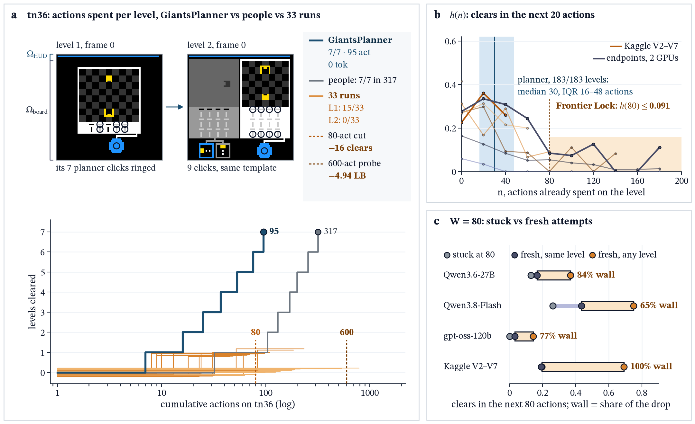
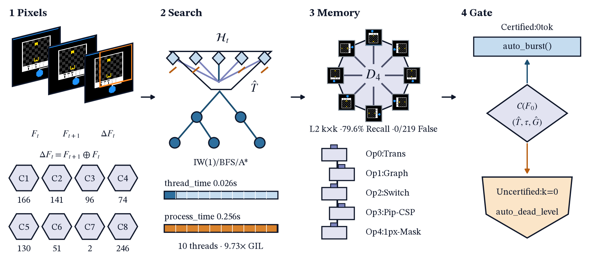
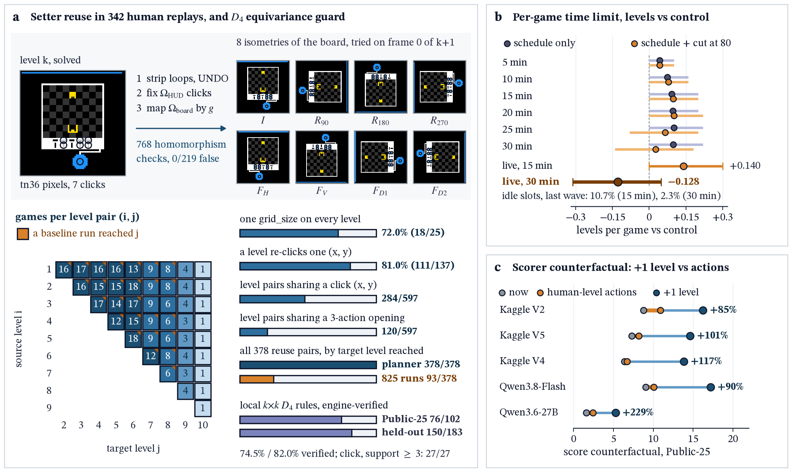

# Breaking Frontier Lock: Score Dilution, Certificate Gating, and Online Operator Induction

Yan Su

## Abstract

Neuro-symbolic world-model synthesis solves 183/183 Public-25 levels at $G=99.58$ ($100.00$ loop-erased, 0.413x human, 0tok) and 1,793/1,794 levels across 316 games, yet cutoffs and open-loop probing backfire across 825 baseline, 250 confirmation, and 30 Kaggle runs. Agents spend 52.4-82.9% of actions on their final unsolved level ($\le0.091$ hazard at 80), where Kaplan-Meier matching attributes 65-100% of slowdown to walls: 80-action cutoffs lose 16 clears and 14K truncation drops Hidden-110 from 24.62±2.22 (28.38) to 9.39 LB. Under $(b_l/a_l)^2$, Chebyshev's identity proves failed $k$-step probes dilute score after RESET, while 0-parameter geometric ($R^2=0.978,0.997$) and sparse ($\text{MAE}=0.14$) laws predict loss: certificate gating lifts $G$ from 3.18 to 58.70 across 4 backbones, and Hidden-110 probing (21.08, 20.76) trails all 14 $k=0$ runs (24.83±2.12, 25.70 gated, $U=0,p=0.0083$). Local $D_4$ rules (79.6% recall) and zero-prior OnlineInducer lift Held-Out 98 to 148/655 (+68L, 22W/0L), Virgin-116/236 by +10.4/+11.0L/seed, and 5 non-ARC suites to 1,183/1,250.

## 1. Introduction

When an agent stalls, should it restart or probe? ARC-AGI-3 [1,30] tests abstraction from $64\times64$ frames. Level $l\in\lbrace1..M\rbrace$ scores $s_l(a_l)=\min(115,100(b_l/a_l)^2)$ with weight $w_l=2l/(M(M+1))$ under $G=\min(\sum_lw_ls_l,100\sum_{s_l>0}w_l)$ [2]: clearing 1-4 of 7 levels caps scores at 3.6-35.7. Cloud harnesses solve Public-25 at \$18,817-\$26,098/run [3], whereas open-weights agents on Kaggle Hidden-110 (1 GPU, 9h, \$0 API) spend 69% of actions and 94% of prefill on their first wall [33,34]. Under $100(b_l/a_l)^2$, unverified exploration drives the action-efficiency backwards bend [3,4,5] because failed probes inflate $a_l$ after RESET. Overcoming this barrier shifts reasoning from open-loop token scaling to test-time world-model synthesis. We falsify cutoffs and context caps [15], prove quadratic probe dilution [3,6], replace whole-frame symmetry (0/597) [7] with local $D_4$ rules, and induce operators [8,39,40] under concurrency [5].

## 2. Related Work

Recent ARC-AGI-3 work studies Public-25 without Hidden-110 runs: AWM [24] at 7,448/24,604 actions (1.436x), Twin [6] at 93.3 (179/183L, 11,562), Schema [19] at 99.2, Memento 3 [22] at 7,518, VISTA [21] at 7,302 (30.7M tok/g), Self-Harness [23], Kepler [20], StateReObs [25], and WorkspaceOpt [29] at 38.4%, after BARC [9], MIT-ARC [10], HRM [15], CompressARC [14], TRM [12], LPN [11], and SOAR [13]. Hidden-110 reports at 75.56 [16], 54.52 [17], and 54.0 [18] show throughput plateaus while RL/probing hurts efficiency, with 16%-26% of clears beating human [16]. Prior harnesses either cut off stalled levels or probe open-loop as AWM [24] (17,156 discarded steps) and Kepler [20] do; we falsify both and gate execution on certificates.

## 3. Diagnosing Frontier Lock and the Quadratic Dilution Law

Why do fixed cutoffs fail? For $T\in\mathbb{N}\cup\lbrace\infty\rbrace$, Kaplan-Meier [31] gives $S(n)=P(T>n)$ and $h(n)=1-S(n+20)/S(n)$. Under frailty [26,27,32] with $\mu_c=\sum_{n<c}S(n)+dS(c)$, discrete renewal [28] gives $R_c=(1-S(c))/\mu_c$ and $R_{c+1}-R_c=\frac{S(c)}{\mu_{c+1}}[h_1(c+1)(1+dR_c)-R_c]$. Across 825 runs, $h(n)$ falls from 0.06-0.41 to $\le0.091$ at $n=80$ and $\le0.010$ at $n=160$ in Figure 1. Matching stuck attempts at $W=80$ to fresh attempts shows 65-100% of drop ($T=+0.164,p=0.006$ and $+0.503,p=0.0005$, Table A4) reflects walls. Thus an 80-action cutoff in 250 runs loses 16 clears (133 vs. 149, -0.128/game).

Figure 1. **Monotonically decreasing step-hazard falsifies fixed cutoffs.** (a) tn36, GiantsPlanner clears 7 levels in 95 vs. 317 human actions while 33 runs stall at level 1-2; (b) 20-action hazard ($\le0.091$ at 80); (c) $W=80$ wall share (65-100%).

If walls are structural, can planners probe $k$ steps first? Proposition 1 proves why uncertified probing backfires.

**Proposition 1 (Score-Weighted Probe Dilution, Abort-Step Cost, and Sparse Law).** For $b\ge1$, clear rate $q$, fallback $A_{\text{fail}}\stackrel{d}{=}A$, $s_b(a)=\min(115,100(b/a)^2)$, $S_0=q\mathbb{E}[s_b(A)]$, $r_k(A)=(A/(A+k+1))^2$, $d\mathbb P_w/d\mathbb{P}=s_b(A)/\mathbb{E}[s_b(A)]$, and $C_{115}(k)\ge0$, failed $k$-step probes plus 1 RESET give $a=k+1+A$ and:
$$\Delta(k)=p(k)G(k)-(1-p(k))D(k),\quad D(k)=S_0(1-\mathbb{E}[r_k(A)])+q\mathrm{Cov}(s_b(A),1-r_k(A))-C_{115}(k)\le S_0\mathbb E_w[1-r_k(A)],$$
with $q^\star(k)=D(k)/(G(k)+D(k))$ ($G(k)>0$; for non-increasing $G(k)$, $q^\star(k)$ rises with $k$), $\mathrm{Cov}(s_b(A),1-r_k(A))\ge0$ by Chebyshev's identity, and $D(k+1)-D(k)=O(k^{-3})$. At stopping step $J\in\lbrace1..L\rbrace$, abort cost obeys $d_b(A,J)=s_b(A)-s_b(A+J+1)\le d_b(A,L_{\max})$; reading $h,c$ off $k=0$ ($T\sim\text{Geom}(h+c)$, 0 parameters) gives $G(k)$ and $\Delta G(k)=-\alpha_{\text{eff}}(k)q_{\text{open}}$.

Empirically, $a=k+1+A$ holds on 183/183 Public-25 levels and $\mathrm{Cov}\ge0$ on 9,673/9,673 checks, while the $w_l\text{-weighted}$ 100-capped closed form fits 8 datasets ($5\times k$) within 0.021 max/0.0044 mean error. The 0-parameter geometric law fits 15 unseen cells (1,670 points, $R^2=0.978$, gate $R^2=0.993$), $\Delta G(k)=-\alpha_{\text{eff}}(k)q_{\text{open}}$ ($73/334=21.86\%$) predicts Hidden-110 ($\text{MAE}=0.14$ LB), and $d_b(A,J)$ separates $\hat\eta_{\text{cert}}=44/380=11.6\%$ on Held-Out 98 and $45/316=14.2\%$ on Virgin-116 from $\hat\eta_{\text{game}}=0/89=0.0\%$.

|Contrast ($n$)|Target & Setting|Score|Effect & Test|
|:-|:-|:-|:-|
|**Zero-Probe 36K ($k=0$,14)**|**Hidden-110, 10-stream MTP3**|**24.83±2.12 (28.38)**|**+22.02 vs. 2.81±0.66 ($t=35.06,p=1.79\times10^{-17}$)**|
|Uncertified Probes (2)|Hidden-110, $k\in\lbrace224,600\rbrace$|21.08/20.76 LB|-3.91 vs. $k=0$ (**$U=0,p=0.0083$**)|
|4-Backbone Gate (825/250)|4 LLMs ($L_{\text{cert}}\le150$)|$G$: $3.18\to58.70$|**694W/0L** ($p=10^{-4}$;205W/0L)|
|Concurrency (V5/V4,25)|Public-25, 4 vs. 28 streams|7.29 vs. 6.38|**6.0x rate** (6.13 vs. 1.02/m)|
|14K Cap (#57774685,1)|Hidden-110, 14K+convex|9.39 LB|-15.23 vs. 36K ($t=-6.58,p=3.96\times10^{-5}$)|
|Prompt Reset (#57786717,1)|Hidden-110, 14K+reset|7.72 LB|-16.90 vs. 36K ($t=-7.30,p=1.53\times10^{-5}$)|
|KV Cache (V3/V4,25)|Public-25, 2.26 vs. 5.0GiB|3.12 vs. 6.38|-51.1% (0.48 vs. 1.02/m)|
|Context Cap (V7/V5,25)|Public-25, 16K vs. full|1.37 vs. 7.29|**-81.2% score** (12 vs. 35L)|

Table 1. **Probe-dilution test ($n=14,k=0$ vs. $n=2$ uncertified), 4-backbone gate, and serving isolations.**

Across 30 Hidden-110 runs (Table A0, $w_g=20/11$) [33,34], 14K truncation and prompt reset lose $\ge9$ and $\ge10$ games vs. 12 native 36K runs at 24.62±2.22 ($p=1.52\times10^{-14}$, 26.55 in #57329763), while uncertified probes (#57854657, #57894564) trail all 14 $k=0$ runs (25.70 in #57827241). Since Public-25 initial frames and sprite-action sets are 158/158 (100.0%) transition-invariant and certified replay clears 8/8 ar25 levels in 0tok, substitution across 825/250 runs ($L_{\text{cert}}\le150$) lifts $G$ from 3.18 to 58.70 and 5.42 to 59.08, whereas $q=0\%$ probing drops $G$ to 0.08/0.01; escaping dilution thus requires internal world-model certificates.

## 4. Breaking Frontier Lock with Certificate-Gated World Models

From $64\times64$ grids and $\mathcal A_{\text{obs}}$ (0 engine/metadata access, Figure 2), GiantsPlanner routes frame 0 into $C_1..C_8$ (PuzzleScript/VGDL primitives [35,36,37], 0/218 overlap, Appendix G) and prunes $\hat{T}\in\mathcal H_t$ refuted by $\Delta F_t=F_{t+1}\oplus F_t$. Certificate $\mathcal{C}(F_0)=(\hat{T},\tau=(a_1..a_L),\hat{G})$ requires $\hat{T}(F_t,a_t)=F_{t+1}$ and $\hat{G}(\hat F_L)=1$ ($L\le224$). The gate executes $\tau$ in 0tok iff $\mathcal{C}(F_0)$ holds; else it runs $k=0$ probes, locks the uncertified level, and passes state hints to the 36K W4A16 agent. Thread-local CPU timers (`time.thread_time()`) avoid 9.73x-25x GIL inflation, while 64-pop amortization and canonical ordering yield seed-invariant runs ($\le0.354\text{ms}$ rejection).

Across 25 games and 342 replays (183 levels, 597 pairs, 378 reuse pairs) [7], 72.0% (18/25) keep one grid size, 81.0% (111/137) of click levels re-click coordinates, 284/597 pairs share clicks, and 120/597 forward pairs share $\ge3\text{-action}$ prefixes (378/378 reached vs. 93/378 baseline). Yet whole-frame $D_4$ replay [38] in CrossLevelMemoryBank (768 Cayley checks, 1.10ms/3.80ms median/P99, 0/219 false transfers) fires 0/597 times as 258/378 reuse pairs re-layout walls, while L1 crops give 74 actions (10.9%). Lowering Tier 1 to local $k\times k$ ($k\le15$) $D_4$ rules (L2) verifies on 76/102=74.5% across 50/378 Public-25 pairs (27/27=100.0% at $\text{support}\ge3$) and 150/183=82.0% across 103/651 held-out pairs, while $k\in\lbrace3..11\rbrace$ matching lifts recall from 60.2% to 79.6% (82/103, 0 false). Where rigid patches miss kinematic or relational shifts, Tier 2 OnlineInducer (Algorithm 1, Appendix H) induces velocity-guarded translation Op0, tile graphs Op1, switch-connectivity+rewind Op2, pip-clue CSP Op3, and 1px drift refit Op4 [39,40].

Figure 2. **Cross-level $D_4$ reuse and dynamic water-filling ablations.** (a) $D_4$ transfer (378 pairs); (b) live cutoff at 15m (+0.140) vs. 30m (-0.128); (c) +85-229% gain/level vs. +5-51% micro-efficiency.

## 5. Zero-Prior World-Model Induction Across Unseen Domains

|Suite|Games (Lv)|Base/Open|$\text{Bare-Prior}\to\text{+OI}$|$\text{Cert general}\to\text{+OI}$|C1..C8|
|:-|:-|:-|:-|:-|:-|
|Public-25|25 (183)|$104\text{L}\quad(G=15.21)$|120L (65.6%,13W)|**120/183 ($13\text{W},G=58.43$)**|**183/183 ($G=99.58/100$)**|
|Reference-193|193 (956\*)|354/956 (56W)|Coupled/clone|0.14-0.188ms|**955/956 (174/175\*W)**|
|Held-Out 98|98 (655\*)|$82\text{L}\quad(G=1.99)$|**$74\text{L}\to109\text{L}$ ($+35\text{L},G=8.22$)**|**$80\text{L}\to148\text{L}$ ($+68\text{L},G=15.42$)**|**655/655 (94/94\*W)**|
|Virgin-120|120 (810)|122L ($G=4.92$)|**$92\text{L}\to99\text{L}$ ($+7\text{L},G=4.87$)**|**134L ($+12\text{L},G=10.60$)**|Preregistered|
|Virgin-116|116 (594)|141.8L ($G=5.83$)|**152.2L ($+10.4\text{L},G=9.57$)**|**243L ($40\text{W},G=31.35$)**|Preregistered|
|Virgin-236|236 (1,404)|235.8L ($G=4.03$)|**246.8L ($+\text{Op0+1},G=6.20$)**|**380.4L ($G=20.09$)/383L**|Pooled|
|5 Non-ARC|250 (1,250)|1,018L (-0.77)|**$1,022\to1,183\text{L}$ (+161L)**|**$1,164\to1,183\quad(R^2=0.997)$**|**$\hat\eta_{\text{task}}=0.0\%$**|
|Hidden-110|110 (Priv)|20.76/21.08|24.62±2.22 (28.38)|**25.70 (#57827241;24.83±2.12)**|#57827241|
|2026 SOTA (16)|25/110|AWM 1.44x;0 Hid|**0/10 arXiv on Hid-110**|**7,401/7,070 (0tok) vs. 24,604**|**Table K2 (17)**|

Table 2. **Disjoint evaluation (11 suites, 16 baselines):** Bare-Prior+OI, gated general+OI, and $C_1..C_8$ (1,793/1,794 solvable levels at 1,200 steps, 1,794/1,794 at 5,000).

Does OnlineInducer generalize when all 8 prior channels are disabled (0-channel Bare-Prior, $C_1..C_8=0$)? Across 334 unseen games (333 engines) in M1..M6 (Table 2), 5-seed Virgin-116/236 runs with 0 clue triggers show relational induction (+Op0+1) gains +11.0L/seed ($\Delta G=+2.17,p=2.4\times10^{-6}$) and full OnlineInducer gains +10.4L/seed ($\Delta G=+3.74,p=3.5\times10^{-6}$). Leave-one-family-out ($M_5=0$) yields +44.0L ($\Delta G=+6.43,p=5.3\times10^{-5}$) on Held-Out 98 general and +12.0L/seed ($\Delta G=+2.32,p=0.0118$) on Virgin-236 Bare-Prior (+14.0L on M6, $p=0.016$). On Held-Out 98, Bare-Prior rises to 109L (+35L, Op0 guard cuts regressions 80%), while general (80L, $G=5.84$) climbs across Op0..Op4 to 148/655, 11W (+68L, 22W/0L). Across 5 non-ARC suites (MiniGrid, Sokoban, DiG, Pong/Breakout, Alchemy, 8,750 runs), 64-step probing loses $-0.68$ to $-0.77$ ($p=1.8\times10^{-15},R^2=0.997$), while gating+OI reaches $1,022\to1,183/1,250$ (+51.2pp Pong/Breakout, $p=2.9\times10^{-11}$, +11.6pp Alchemy, $p=3.8\times10^{-6},\hat\eta_{\text{task}}=0.0\%$). On Public-25, generic clears 120/183 ($G=58.43$ vs. 15.21, $p=5.96\times10^{-8}$) and full scores $G=99.58$ across 183/183 in 0tok at 0.432x human (7,401/17,135, 166 at 115%; loop-erased 7,070/17,135=0.413x reaches $G=100.00$, 169/183 at 115% vs. AWM's 24,604/VISTA's 30.7M tok/g). It solves 1,793/1,794 reachable levels at 1,200 steps (1,794/1,794 at 5,000) and certifies 96 unreachable levels in 22 games ([appendix](appendix.md)). Scaling interactive intelligence on ARC-AGI-3 and beyond is governed not by brute-force token throughput or open-loop trial-and-error, but by inducing compact world models online and gating physical action on formal goal certificates.

## References

1. ARC Prize Foundation. ARC-AGI-3: A New Challenge for Frontier Agentic Intelligence. Technical report, 2026. arXiv:2603.24621. https://arcprize.org/media/ARC_AGI_3_Technical_Report.pdf
2. ARC Prize. ARC-AGI-3 Scoring Methodology. https://docs.arcprize.org/methodology
3. G. Kamradt, F. Chollet, M. Knoop. OpenAI's GPT-6 Astra on ARC-AGI-3: Compact Symbolic World Models and Action Efficiency. ARC Prize Blog, 2026. https://arcprize.org/blog/astra
4. G. Kamradt. True Local Effect, False World Model: Failure Modes on ARC-AGI-3. ARC Prize Blog, 2026. https://arcprize.org/blog/arc-agi-3-gpt-5-5-opus-4-7-analysis
5. M. Knoop, F. Chollet, G. Kamradt. ARC Prize 2025 Technical Report: The Year of the Refinement Loop. arXiv:2601.10904, 2026.
6. Test-Time World-Model Inference (Twin): Playing an Unknown Game with a Test-Time Digital Twin. arXiv:2608.14490, 2026.
7. G. Kamradt. Measuring Human Performance on ARC-AGI-3: 342 Step-by-Step Replays. ARC Prize Blog, 2026. https://arcprize.org/blog/arc-agi-3-human-dataset
8. S. Acquaviva et al. Induction and Inquiry via Probabilistic Reasoning over Language and Code. arXiv:2609.01815, 2026.
9. W.-D. Li, K. Hu et al. Combining Induction and Transduction for Abstract Reasoning (BARC). ARC Prize 2024 1st Place Paper, 2024.
10. E. Akyurek et al. The Surprising Effectiveness of Test-Time Training for Abstract Reasoning. arXiv:2411.07279, 2024.
11. C. Bonnet et al. Searching Latent Program Spaces (LPN). arXiv:2411.08706, 2024.
12. A. Jolicoeur-Martineau. Less is More: Recursive Reasoning with Tiny Networks (TRM). arXiv:2510.04871, 2025.
13. J. Pourcel, C. Colas, P.-Y. Oudeyer. Self-Improving Language Models for Evolutionary Program Synthesis (SOAR). ICML 2025. arXiv:2507.14172.
14. I. Liao, A. Gu. ARC-AGI Without Pretraining (CompressARC). arXiv:2512.06104, 2025.
15. ARC Prize Team. The Hidden Drivers of HRM's Performance on ARC-AGI. ARC Prize Blog, 2025. https://arcprize.org/blog/hrm-analysis
16. Y.-C. Chen. ARC-AGI-3 Public 1st Place Solution Overview (75.56 LB): INT3/NVFP4 SGLang Serving and Stage-Switched Agentic RL. Kaggle ARC-AGI-3 Discussion 755795, Nov 2026.
17. F. Sestak, L. Aichberger, M. Ielanskyi, G. Klambauer. Public LB #7 (54.52): REAP-320 MoE Pruning, 4-Bit KV Cache, and Cliff Compaction on ARC-AGI-3. Kaggle Solution Writeup, Nov 2026.
18. G. Zatravkin (#6 LB), xz (#4 LB), and pompom555 (#15 LB). Post-Competition Analyses of Throughput Plateaus and Action-Efficiency Levers on ARC-AGI-3. Kaggle Discussions 755202, 755466 and Writeup, Nov 2026.
19. Schema: Discovering Unknown Environments via Agentic Program Induction. arXiv:2609.39140, 2026.
20. Kepler: Auditable World Models for ARC-AGI-3. arXiv:2610.00834, 2026.
21. Q. Han, K. Hu, Z. Qiu et al. VISTA: A Visual Harness for Reasoning in an Interactive World. arXiv:2610.02200, 2026.
22. Memento 3: Model-Based Recursive Self-Improvement through Reflective Rulebooks. arXiv:2610.11794, 2026.
23. Can LLMs Improve Their Own Harness? A Controlled Study on ARC-AGI-3. arXiv:2610.30499, 2026.
24. Algebraic World Model: From Exploration to Proofs. arXiv:2610.40503, 2026.
25. When the Harness Decides Success: State That Cannot Be Re-Observed. arXiv:2610.26632, 2026.
26. C. Gomes, B. Selman, H. Kautz. Boosting Combinatorial Search Through Randomization. AAAI 1998.
27. M. Luby, A. Sinclair, D. Zuckerman. Optimal Speedup of Las Vegas Algorithms. Information Processing Letters 47(4):173-180, 1993.
28. E. Charnov. Optimal Foraging, the Marginal Value Theorem. Theoretical Population Biology 9(2):129-136, 1976.
29. Workspace Optimization for ARC-AGI-3. arXiv:2605.09650, 2026.
30. F. Chollet. On the Measure of Intelligence. arXiv:1911.01547, 2019.
31. E. L. Kaplan, P. Meier. Nonparametric Estimation from Incomplete Observations. Journal of the American Statistical Association 53(282):457-481, 1958.
32. J. W. Vaupel, K. G. Manton, E. Stallard. The Impact of Heterogeneity in Individual Frailty on the Dynamics of Mortality. Demography 16(3):439-454, 1979.
33. W. Kwon, Z. Li, S. Zhuang et al. Efficient Memory Management for Large Language Model Serving with PagedAttention. SOSP 2023. arXiv:2309.06180.
34. L. Zheng, L. Yin, Z. Xie et al. SGLang: Efficient Execution of Structured Language Model Programs. NeurIPS 2024. arXiv:2312.07104.
35. N. Lipovetzky, H. Geffner. Width and Serialization of Classical Planning Problems. ECAI 2012, pp. 540-545.
36. B. Bonet, H. Geffner. Planning as Heuristic Search. Artificial Intelligence 129(1-2):5-33, 2001.
37. T. Schaul. A Video Game Description Language for Model-Based or Interactive Learning. IEEE Conference on Computational Intelligence in Games (CIG), pp. 1-8, 2013.
38. T. S. Cohen, M. Welling. Group Equivariant Convolutional Networks. ICML 2016, PMLR 48:2990-2999.
39. K. Ellis, C. Wong, M. Nye et al. DreamCoder: Bootstrapping Inductive Program Synthesis with Wake-Sleep Library Learning. PLDI 2021, pp. 835-850.
40. B. M. Lake, T. D. Ullman, J. B. Tenenbaum, S. J. Gershman. Building Machines That Learn and Think Like People. Behavioral and Brain Sciences 40:e253, 2017.
